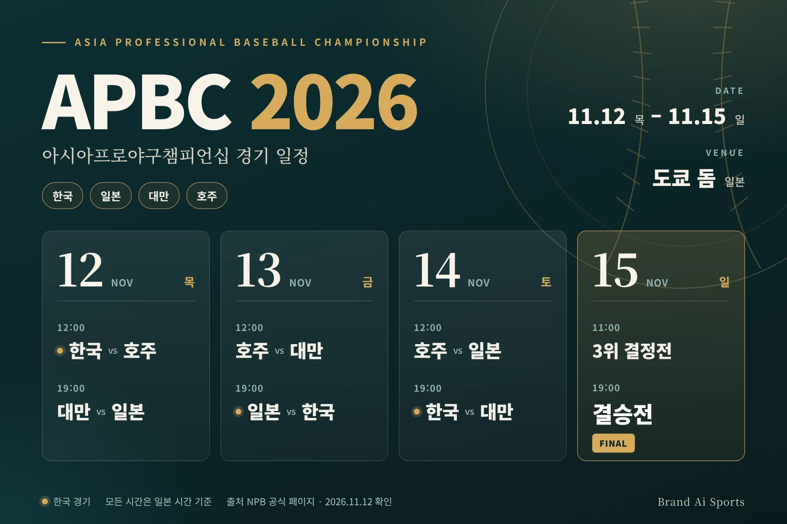
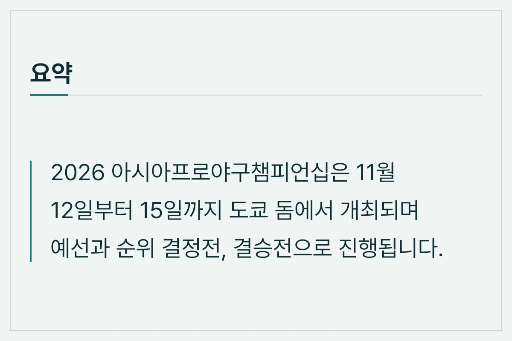
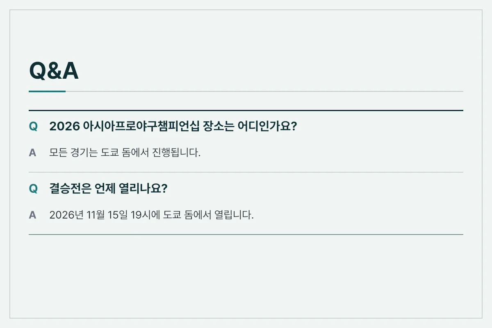
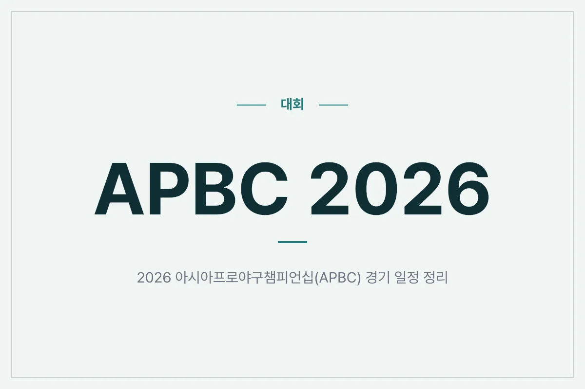

2026 아시아프로야구챔피언십(APBC)은 **일본의 우승, 한국의 준우승**으로 끝났습니다. 한국은 11월 15일 도쿄 돔 결승에서 일본에 **1-5**로 졌고, 2017년·2023년에 이어 세 대회 연속 결승에서 일본에 막혀 준우승에 머물렀습니다. 일본은 풀리그부터 결승까지 4전 전승으로 대회 3연패를 달성했습니다. 아래는 NPB 공식 일정과 경기 결과 보도를 바탕으로 정리한 내용입니다.

<figure>

<figcaption>2026 아시아프로야구챔피언십 주요 일정 정보</figcaption>
</figure>

## APBC는 어떤 대회인가

APBC는 젊은 선수들의 국제 경쟁력을 키우기 위해 2017년에 만들어진 대회로, 2026년이 세 번째 대회입니다. 한국, 일본, 대만, 호주 4개국이 참가했습니다.

출전 자격은 다음과 같습니다(일간스포츠 보도 기준).

- **24세 이하:** 2002년 1월 1일 이후 출생
- **또는 프로 입단 3년 차 이내:** 2024년 이후 입단
- **와일드카드:** 29세 이하(1997년 1월 1일 이후 출생) 선수 최대 3명

한국 대표팀은 최원호 감독을 중심으로 투수 14명, 포수 2명, 내야수 7명, 외야수 5명 등 **28명**으로 꾸려졌습니다.

## 일자별 경기 일정 (일본 시간)

NPB 공식 페이지에 나온 일정입니다. 모든 경기는 도쿄 돔에서 열렸습니다.

| 날짜 | 12:00 경기 | 19:00 경기 |
| --- | --- | --- |
| 11월 12일(목) | 한국 vs 호주 | 대만 vs 일본 |
| 11월 13일(금) | 호주 vs 대만 | 일본 vs 한국 |
| 11월 14일(토) | 호주 vs 일본 | 한국 vs 대만 |

마지막 날인 **11월 15일(일)**에는 11시에 3위 결정전, 19시에 결승전이 열렸습니다.

<figure>

<figcaption>도쿄 돔에서 열리는 2026 APBC 일정 안내</figcaption>
</figure>

## 한국 대표팀 경기 결과

| 경기 | 상대 | 결과 |
| --- | --- | --- |
| 풀리그 1차전 | 호주 | 7-8 패 |
| 풀리그 2차전 | 일본 | 5-9 패 |
| 풀리그 3차전 | 대만 | 6-4 승 |
| 결승 | 일본 | 1-5 패 |

풀리그에서 한국, 대만, 호주가 나란히 **1승 2패**로 동률이었습니다. 대회 규정에 따라 동률 팀 순위를 가리는 **TQB(Team Quality Balance)**를 적용한 결과 한국이 2위로 결승에 올랐습니다. 풀리그 최종 순위는 일본(3승), 한국, 대만, 호주 순입니다.

TQB는 풀리그 전 경기의 득점과 실점을 비교하는 동률 팀 순위 공식입니다. 연합뉴스 보도에 따르면 한국은 이 공식으로 대만을 밀어내고 결승에 올랐습니다.

## 결승행을 결정한 대만전 (6-4 승)

연합뉴스 보도로 본 대만전 흐름입니다.

- **3회말:** 9번 타자 박재현이 선두 타자로 나와 선제 솔로 홈런을 쳤습니다. 이어 몸에 맞는 공 3개로 만든 1사 만루에서 김휘집의 적시타, 안재석의 좌전 적시타로 3-0까지 달아났습니다.
- **5회초:** 무실점으로 삼진 7개를 잡던 선발 이로운이 솔로 홈런과 2점 홈런을 맞아 3-3 동점이 됐습니다.
- **5회말:** 김도영이 선두 타자로 나와 바로 솔로 홈런을 쳐 다시 앞서갔습니다.
- **7회말:** 4회부터 1루수로 들어간 문정빈이 좌중간 솔로 홈런을 쳐 6-4로 점수를 벌렸습니다.

이 승리로 한국은 1승 2패를 맞췄고, TQB에서 앞서 결승에 진출했습니다.

## 한국 대표팀 주요 선수

톱스타뉴스가 정리한 명단 가운데 주요 선수는 이렇습니다.

- **투수:** 김건우, 김민준, 이로운, 김진욱 등
- **내야수:** 김도영, 김주원, 김휘집, 한동희, 이재현 등
- **외야수:** 문현빈, 김지찬, 안현민, 박재현, 김민석

## 결승전은 어떻게 흘러갔나

일간스포츠 보도에 따르면 한국 선발 김건우는 1회 말 2사 후 니시카와 미쇼에게 선제 홈런을, 3회 말에는 미네야마 루이에게 1타점 2루타를 맞았습니다. 승부는 5회 말에 갈렸습니다. 무사 1루에서 희생번트 타구를 1루로 악송구한 뒤, 무사 1·2루에서 마사키 도모야에게 3점 홈런을 허용했습니다.

김건우는 4이닝 6피안타(2피홈런) 5실점(4자책점)으로 패전 투수가 됐습니다. 한국 타선은 5안타에 그쳤고, 일본 선발 다카하시 히로토는 7이닝 4피안타 7탈삼진 1실점으로 호투했습니다.

이 패배로 한국은 프로 선수가 참가한 국제대회 일본전 **13연패**를 이어갔습니다. 마지막 승리는 2015년 11월 WBSC 프리미어12 준결승입니다.

<figure>

<figcaption>2026 APBC 일정 관련 FAQ</figcaption>
</figure>

## 역대 APBC에서 한국과 일본

APBC는 지금까지 세 번 열렸고, 세 번 모두 결승이 한일전이었습니다.

| 대회 | 우승 | 준우승 |
| --- | --- | --- |
| 1회 (2017년) | 일본 | 한국 |
| 2회 (2023년) | 일본 | 한국 |
| 3회 (2026년) | 일본 | 한국 |

일간스포츠는 한국이 이번 대회에서도 풀리그(5-9)와 결승(1-5) 두 번 모두 일본에 졌다고 전했습니다. 젊은 선수 위주로 꾸리는 대회인 만큼, 이번에 뛴 선수들이 앞으로 국가대표 주축으로 얼마나 성장할지가 관심사입니다.

## 중계는 어디서 했나

톱스타뉴스 보도에 따르면 대회 전 경기가 KBSN스포츠, MBC스포츠플러스, SBS스포츠, SPOTV로 생중계됐고, CGV에서도 한국 대표팀 경기를 극장 생중계했습니다. 다음 대회 중계 정보는 대회 직전 KBO 공지를 확인하세요.

## 자주 묻는 질문

**2026 APBC 우승팀은 어디인가요?**

일본입니다. 풀리그 3전 전승에 이어 결승에서 한국을 5-1로 꺾어 4전 전승으로 우승했고, 2017년·2023년에 이어 3연패를 달성했습니다.

**한국은 예선에서 1승 2패인데 어떻게 결승에 갔나요?**

한국, 대만, 호주가 모두 1승 2패로 동률이었고, 동률 팀 순위를 가리는 TQB 규정으로 한국이 2위가 돼 결승에 진출했습니다.

**APBC에는 어떤 선수가 나갈 수 있나요?**

24세 이하(2002년 1월 1일 이후 출생) 또는 프로 입단 3년 차 이내(2024년 이후 입단) 선수가 기본이고, 29세 이하 와일드카드 선수를 최대 3명까지 뽑을 수 있습니다.

<figure>

<figcaption>2026 APBC 핵심 일정 요약</figcaption>
</figure>

## 참고한 자료

- [NPB(일본야구기구) 아시아프로야구챔피언십 2026 공식 페이지](https://npb.jp/apbc/2026/) — npb.jp, 확인일 2026-11-12
- [[APBC] 한국 야구, 또 일본에 무릎…대회 3회 연속 준우승·일본전 13연패](https://isplus.com/article/view/isp202611150101) — 일간스포츠, 2026-11-15 보도, 확인일 2026-11-26
- [한국 야구, APBC 결승서 일본에 1-5 패배…3회 연속 준우승](https://www.topstarnews.net/news/articleView.html?idxno=16277300) — 톱스타뉴스, 2026-11-15 보도, 확인일 2026-11-26
- [한국 야구, APBC 결승 진출…대만 6-4 제압 (박재현 선제 솔로포 포함 2타점…김도영 결승포·문정빈 쐐기포)](https://www.koreancenter.or.kr/news/articleView.html?idxno=1439424) — 연합뉴스(한민족센터 게재), 2026-11-14 보도, 확인일 2026-11-26
- [2026 APBC 결승 중계 어디서?…한국 VS 일본, 예선 순위→선발 투수·명단 보니](https://www.topstarnews.net/news/articleView.html?idxno=16277014) — 톱스타뉴스, 2026-11-15 보도, 확인일 2026-11-26

정보 기준일: 2026-11-26. 이 글은 위 자료를 바탕으로 정리했습니다. 기록은 공식 기록과 다를 경우 공식 기록을 따릅니다.
