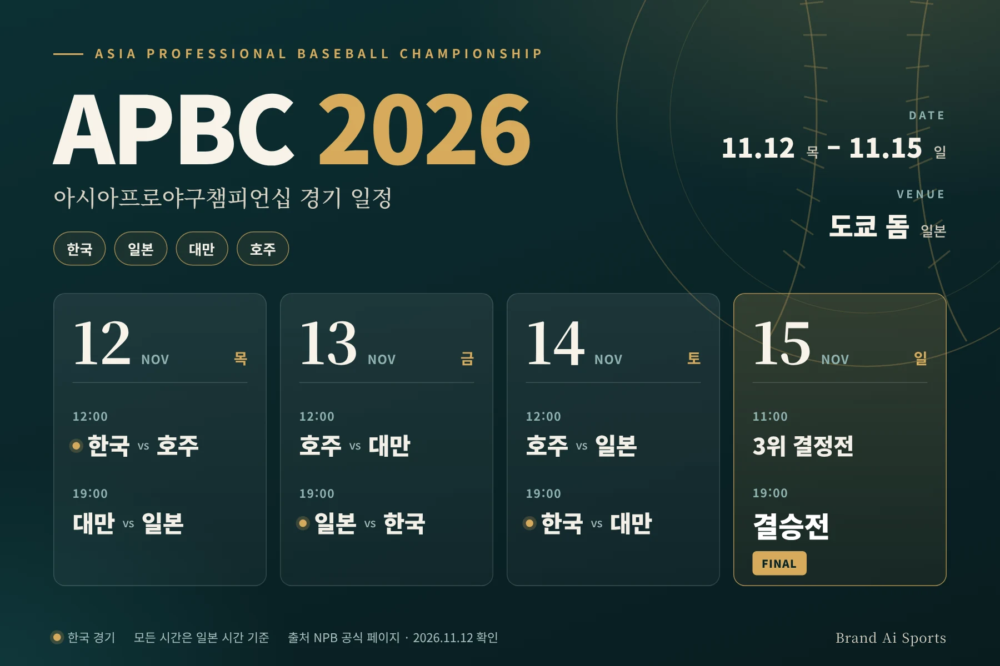
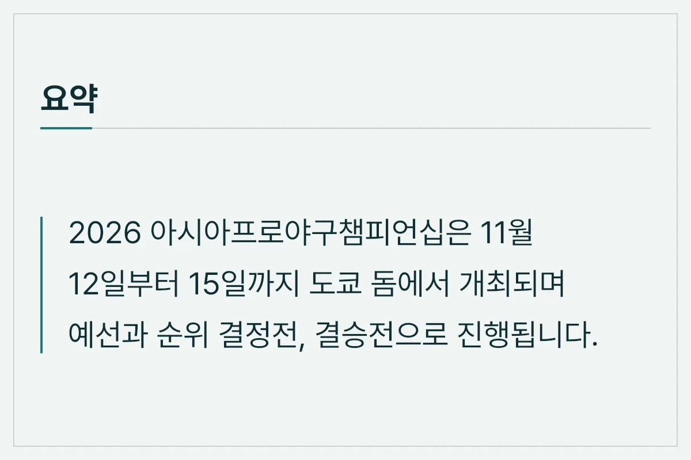
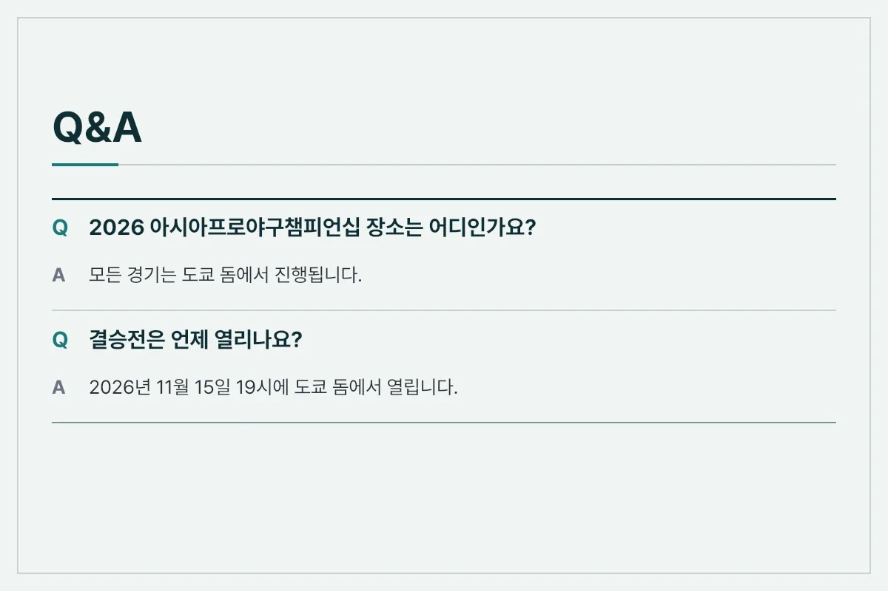
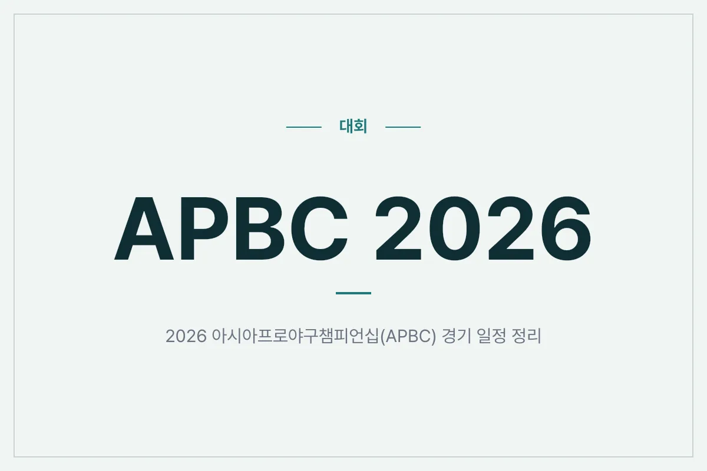

2026 아시아프로야구챔피언십(APBC)은 2026년 11월 12일부터 11월 15일까지 일본 도쿄 돔에서 개최됩니다. 이번 대회는 한국, 일본, 대만, 호주 등 4개국이 참가합니다.

<figure>

<figcaption>2026 아시아프로야구챔피언십 주요 일정 정보</figcaption>
</figure>

## 2026 APBC 대회 개요 및 경기 일정

공식 자료에 따르면 이번 대회는 11월 12일 목요일부터 11월 15일 일요일까지 도쿄 돔에서 열립니다. 11월 12일부터 14일까지 매일 두 경기씩 열리고, 마지막 날인 15일에 3위 결정전과 결승전이 진행됩니다.

### 일자별 경기 일정 세부 내용

모든 시간은 일본 시간 기준입니다.

- **11월 12일 (목요일)**
  - 12:00: 한국 vs. 호주
  - 19:00: 대만 vs. 일본
- **11월 13일 (금요일)**
  - 12:00: 호주 vs. 대만
  - 19:00: 일본 vs. 한국
- **11월 14일 (토요일)**
  - 12:00: 호주 vs. 일본
  - 19:00: 한국 vs. 대만
- **11월 15일 (일요일)**
  - 11:00: 3위 결정전
  - 19:00: 결승전

<figure>

<figcaption>도쿄 돔에서 열리는 2026 APBC 일정 안내</figcaption>
</figure>

## 출전 팀 안내

공식 자료에 나온 참가 팀은 일본, 대만, 한국, 호주 대표팀입니다. 경기 일정 외의 자세한 내용은 아래 참고 자료의 공식 페이지에서 확인하세요.

<figure>

<figcaption>2026 APBC 일정 관련 FAQ</figcaption>
</figure>

## 자주 묻는 질문 (FAQ)

**Q. 2026 아시아프로야구챔피언십은 어디에서 개최되나요?**

A. 모든 경기는 일본 도쿄 돔에서 진행됩니다.

**Q. 결승전과 3위 결정전은 언제 열리나요?**

A. 대회 마지막 날인 11월 15일 일요일에 진행됩니다. 3위 결정전은 오전 11시, 결승전은 오후 7시에 열립니다.

<figure>

<figcaption>2026 APBC 핵심 일정 요약</figcaption>
</figure>

## 마무리 요약

2026 아시아프로야구챔피언십(APBC)은 11월 12일부터 15일까지 도쿄 돔에서 열립니다. 한국은 12일 호주전을 시작으로 13일 일본, 14일 대만과 경기를 치릅니다. 일정은 바뀔 수 있으니 정확한 내용은 공식 페이지에서 확인하시기 바랍니다.

## 참고한 자료

- [NPB(일본야구기구) 아시아프로야구챔피언십 2026 공식 페이지](https://npb.jp/apbc/2026/) — npb.jp, 확인일 2026-11-12

정보 기준일: 2026-11-12. 이 글은 위에 적은 자료를 바탕으로 정리했습니다. 제도·일정·가격·기록 등은 바뀔 수 있으니 중요한 결정 전에는 공식 페이지에서 다시 확인하세요.
