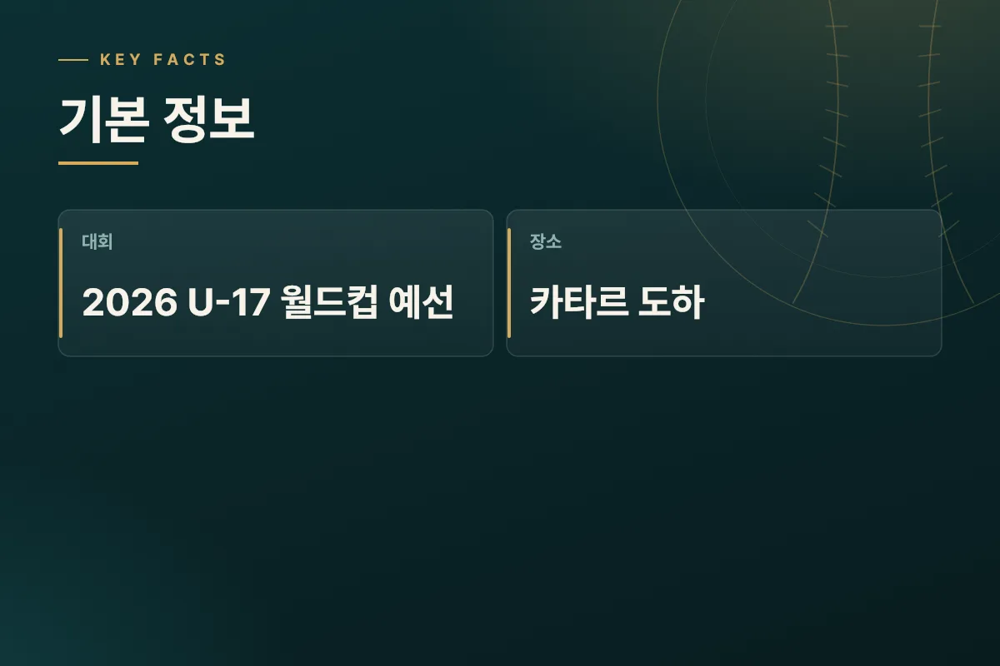
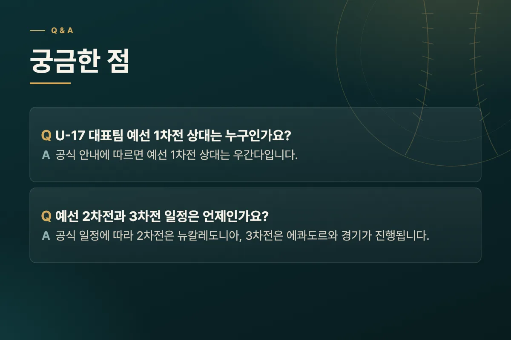
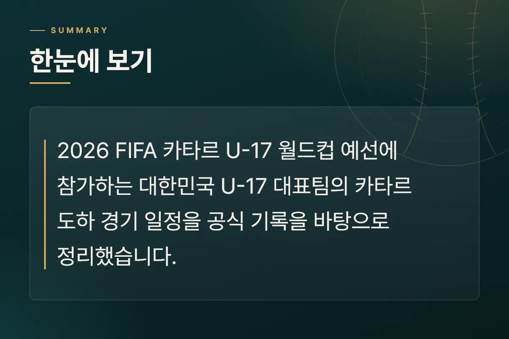

2026년 11월 18일 기준 대한축구협회(KFA) 공식 기록에 따르면, 대한민국 U-17 축구 국가대표팀은 카타르 도하에서 열리는 2026 FIFA 카타르 U-17 월드컵 예선 일정을 소화할 예정입니다. 이번 예선전은 카타르 도하에서 진행되며, 총 3경기의 조별 예선 일정이 공지되어 있습니다. 성인 국가대표팀 일정이 아닌 U-17 연령별 대표팀의 공식 경기 일정 정보를 확인하실 수 있습니다.

<figure>

<figcaption>대한민국 U-17 대표팀 예선 경기 일정 정보</figcaption>
</figure>

## 2026 FIFA 카타르 U-17 월드컵 예선 경기 일정

대한축구협회(KFA) 공식 자료에 명시된 U-17 대표팀의 예선 대진 및 시간 정보는 다음과 같습니다. 모든 경기는 카타르 도하에서 치러집니다.

- 예선 1차전: 11월 19일 목요일 오후 10시 30분, 대한민국 대 우간다
- 예선 2차전: 11월 22일 일요일 오후 11시 30분, 대한민국 대 뉴칼레도니아
- 예선 3차전: 11월 25일 수요일 오후 9시 30분, 대한민국 대 에콰도르

위 일정은 KFA Live 경기 일정 자료를 기준으로 작성되었습니다.

<figure>

<figcaption>대한민국 U-17 대표팀 경기 일정 관련 FAQ</figcaption>
</figure>

## 자주 묻는 질문

**U-17 대표팀의 예선전 장소는 어디인가요?**

공식 안내에 따르면 이번 2026 FIFA 카타르 U-17 월드컵 예선은 카타르 도하에서 열립니다.

**중계 방송이나 티켓 예매 정보는 어디서 확인할 수 있나요?**

대진 방식, 티켓, 중계 및 방송에 관한 상세한 내용은 공식 페이지에서 확인하세요. 공식 기록에 관련 정보가 적혀 있지 않은 항목은 지어내어 쓸 수 없습니다.

<figure>

<figcaption>2026 카타르 U-17 월드컵 예선 요약</figcaption>
</figure>

## 마무리

대한축구협회 공식 자료에 기반한 2026 FIFA 카타르 U-17 월드컵 예선 일정을 살펴보았습니다. 우간다, 뉴칼레도니아, 에콰도르와의 경기가 차례대로 예정되어 있으니 날짜와 시간을 확인하여 경기를 시청하시기 바랍니다. 추가적인 선수 명단이나 대회 관련 세부 사항은 공식 채널을 통해 확인하시기 바랍니다.

## 참고한 자료

- [KFA | 대한축구협회](https://www.kfa.or.kr/) — kfa.or.kr, 확인일 2026-11-18

정보 기준일: 2026-11-18. 이 글은 위에 적은 자료를 바탕으로 정리했습니다. 제도·일정·가격·기록 등은 바뀔 수 있으니 중요한 결정 전에는 공식 페이지에서 다시 확인하세요.
