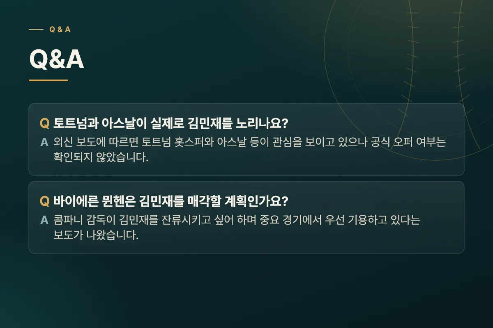
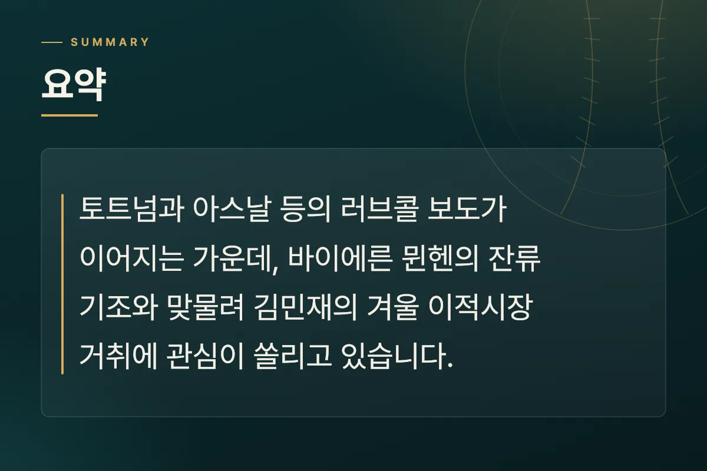

2026년 11월 21일 기준, 바이에른 뮌헨에서 활약 중인 김민재를 향해 잉글랜드 프리미어리그 구단들이 영입 관심을 보이고 있다는 외신 보도가 연일 이어지고 있습니다. 토트넘 홋스퍼와 아스날, 아스톤 빌라 등이 김민재의 행보를 주시하는 후보로 거론되는 가운데, 바이에른 뮌헨 내부의 잔류 방침과 콤파니 감독의 기용 방식이 맞물려 다양한 관측이 제기되는 중입니다. 국내 언론이 인용한 여러 유럽 현지 보도를 바탕으로 현재 프리미어리그 이적설의 배경과 실체를 상세히 짚어봅니다.

<figure>

<figcaption>김민재 이적설 핵심 스펙 요약</figcaption>
</figure>

유럽 축구계를 중심으로 확산하고 있는 이번 프리미어리그 이적설의 진원지는 현지 기자들의 SNS와 전문 매체 보도입니다. 마이데일리가 2026년 11월 21일 보도한 바에 따르면, '아프리칸 풋볼'은 에크렘 코누르 기자의 소식을 인용해 토트넘 홋스퍼와 아스날, 아스톤 빌라가 김민재에게 러브콜을 보내고 있다고 전했습니다. 여기에 이탈리아 세리에 A의 명문 구단인 AC 밀란 역시 김민재의 상황을 예의주시하고 있다는 내용이 더해졌습니다. 과거 페네르바체에서 활약했던 이력이 있는 만큼 친정팀의 재영입 추진설까지 함께 거론되며 겨울 이적시장을 앞두고 축구 팬들의 이목이 집중되고 있습니다.

다만 이러한 외신 보도들이 실제 구체적인 이적 협상이나 오퍼 단계로 이어졌는지는 아직 명확히 확인되지 않았습니다. 해외 축구 시장에서 대형 수비수의 이름이 여러 빅클럽과 연이어 묶이는 것은 흔히 일어나는 일이지만, 선수 본인이나 구단 차원에서 공식적인 이적 의사를 밝힌 적은 없습니다. 특히 토트넘 홋스퍼와 아스날 등 런던 연고의 라이벌 구단들이 동시에 언급되는 것은 그만큼 유럽 무대에서 김민재가 지닌 수비수로서의 가치와 경쟁력을 높게 평가하고 있음을 방증합니다. 마이데일리의 11월 17일 및 18일 보도에서도 이러한 영입 후보군 거론 사실은 일관되게 나타나고 있으나, 구체적인 계약 조건이나 이적료 규모에 대해서는 언론 보도마다 온도 차가 존재합니다.

<figure>

<figcaption>주요 영입 관심 구단 현황</figcaption>
</figure>

외신 보도와 맞물려 가장 주목해야 할 점은 바이에른 뮌헨 구단 내부의 단호한 잔류 기조입니다. 마이데일리가 영국 '풋볼 인사이더'의 피터 오 루크 기자를 인용해 2026년 11월 18일 보도한 내용에 따르면, 바이에른 뮌헨의 콤파니 감독은 김민재를 팀에 잔류시키고 싶어 하는 확고한 의지를 가지고 있습니다. 콤파니 감독은 시즌 중 치러지는 중요한 경기에서 김민재를 우선 기용하며 두터운 신뢰를 보내고 있는 것으로 전해졌습니다. 수비진의 안정화를 도모해야 하는 바이에른 뮌헨 입장에서는 주전급 기량을 갖춘 중앙 수비수를 시즌 도중 쉽게 내어줄 이유가 없다는 분석이 지배적입니다.

이러한 구단 내부의 분위기와 감독의 신임은 외부의 거센 이적설과 정면으로 대치되는 부분입니다. 토트넘 홋스퍼와 아스날 등이 수비 보강을 위해 영입 타당성을 검토하고 있다는 분석이 매일같이 쏟아지고 있지만, 바이에른 뮌헨이 선수를 매각할 의사가 없다면 실제 이적 성사 가능성은 급격히 낮아질 수밖에 없습니다. 과거 에이전트 관련 분쟁이나 타 선수들의 이적설이 소란을 일으켰던 것과 달리, 김민재의 경우는 철저히 경기력과 감독의 전술적 선택에 기반하여 거취가 결정될 것으로 보입니다. 따라서 겨울 이적시장이 열리기 전까지는 언론을 통한 다양한 루머와 잔류설이 혼재할 가능성이 큽니다.

| 구분 | 주요 내용 | 관련 매체 및 출처 |
| :--- | :--- | :--- |
| 관심 구단 | 토트넘 홋스퍼, 아스날, 아스톤 빌라, AC 밀란 | 마이데일리 (2026년 11월 17일~21일 보도) |
| 뮌헨 입장 | 콤파니 감독의 잔류 선호 및 중요 경기 기용 | 마이데일리 (2026년 11월 18일 보도) |
| 기타 이적설 | 페네르바체 재영입 추진설 | 마이데일리 (2026년 11월 18일 보도) |

결과적으로 현재 제기되는 프리미어리그 이적설은 다수의 외신이 전하는 '관심의 표현' 성격이 짙습니다. 토트넘 홋스퍼와 아스날이 김민재를 주시하고 있다는 보도 자체는 사실이지만, 바이에른 뮌헨이 선수를 지키겠다는 입장을 고수하는 한 구체적인 이적 가시화 여부는 [확인 필요] 상태로 남게 됩니다. 겨울 이적시장이 다가올수록 이러한 영입설은 더욱 증폭될 수 있으나, 실제 선수의 이동으로 이어질지는 구단 간의 이해관계와 콤파니 감독의 시즌 운용 계획에 전적으로 달려 있습니다.

<figure>

<figcaption>김민재 프리미어리그 이적설 FAQ</figcaption>
</figure>

**토트넘과 아스날이 김민재에게 실제로 관심을 보이고 있나요?**

아프리칸 풋볼 등 외신 보도에 따르면 토트넘 홋스퍼와 아스날, 아스톤 빌라 등이 김민재의 상황을 주시하고 있는 것으로 나타났습니다. 다만 이는 언론을 통해 보도된 영입 관심 단계이며, 구체적인 공식 오퍼나 협상 진전 여부는 [확인 필요] 상태입니다.

**바이에른 뮌헨은 김민재를 매각할 계획이 있나요?**

영국 풋볼 인사이더 보도에 따르면 콤파니 감독은 김민재를 팀에 잔류시키고 싶어 하며 중요한 경기에서 우선 기용하고 있습니다. 구단 차원에서 선수를 내보내려 한다는 구체적인 정황은 확인되지 않았습니다.

**페네르바체 복귀설도 보도 내용에 포함되나요?**

일부 매체에서 친정팀 페네르바체의 재영입 추진설을 다루었으나 토트넘과 아스날 등 프리미어리그 구단들과의 경쟁이 불가피할 것으로 전망됩니다. 이 역시 언론 보도에 기반한 내용이며 실제 성사 여부는 알 수 없습니다.

<figure>

<figcaption>김민재 이적설 최종 요약</figcaption>
</figure>

2026년 11월 현재 김민재를 둘러싼 프리미어리그 클럽들의 러브콜은 다수의 외신을 통해 동시다발적으로 보도되고 있습니다. 토트넘 홋스퍼와 아스날 등의 관심은 수비수로서의 높은 가치를 증명하지만, 콤파니 감독 체제에서 핵심적인 역할을 맡고 있는 바이에른 뮌헨의 잔류 의사가 강력한 만큼 겨울 이적시장에서 실제 거취가 어떻게 변동될지는 지속적인 추이가 필요합니다.

## 참고한 자료

- ['韓 축구' 미친 희소식! 김민재 EPL서 '러브콜' 폭발, 토트넘-아스날-아...](https://www.mydaily.co.kr/page/view/2026112100593669289) — mydaily.co.kr, 2026-11-21 보도
- ["갱단이 전화해서 협박했다" 무드릭의 충격 고백...10년 믿었던 에이전...](http://www.osen.co.kr/article/G1112912599) — OSEN, 2026-11-20 보도
- ['포체티노 부임' 맨유, 이적 시장에서 전폭적인 지원…첫 번째 영입 타...](https://www.mydaily.co.kr/page/view/2026111909372136693) — mydaily.co.kr, 2026-11-19 보도
- ['주전 경쟁' 김민재 미친 희소식! "중요한 경기서 우선 기용" 콤파니 감...](https://www.mydaily.co.kr/page/view/2026111807082697382) — mydaily.co.kr, 2026-11-18 보도
- ['맙소사' 김민재 '충격 복귀설' 등장! '친정팀' 페네르바체 재영입 추진...](https://www.mydaily.co.kr/page/view/2026111720434058165) — mydaily.co.kr, 2026-11-18 보도
- ['초대박이다' 맨체스터 유나이티드 포체티노 체제 1호 영입 후보 등장!...](https://mhnse.com/news/articleView.html?idxno=1700964) — mhnse.com, 2026-11-18 보도

2026년 11월 21일 기준으로 정리했습니다. 일정이나 금액처럼 바뀔 수 있는 내용은 위 참고 자료에서 한 번 더 확인해 주세요.
