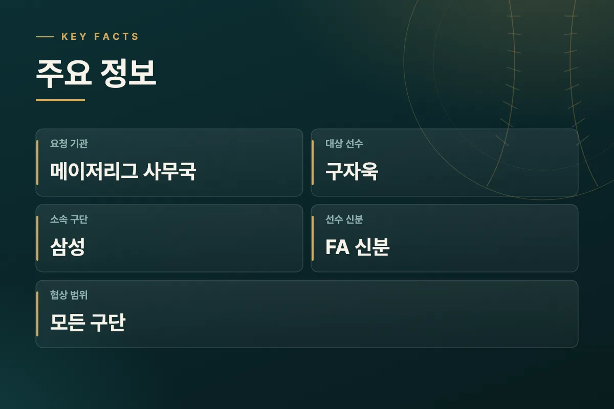
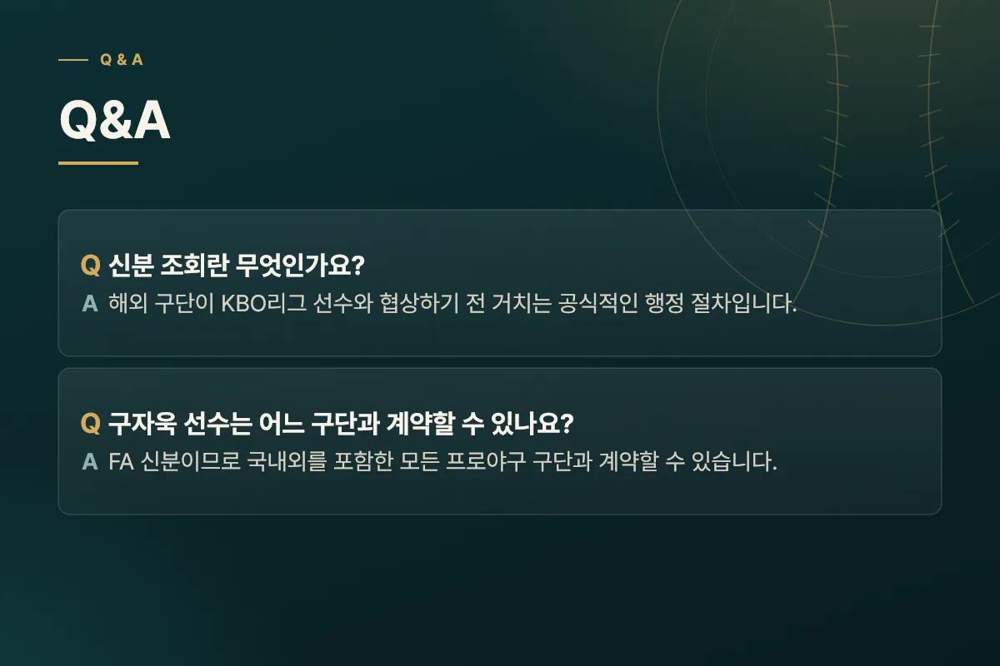
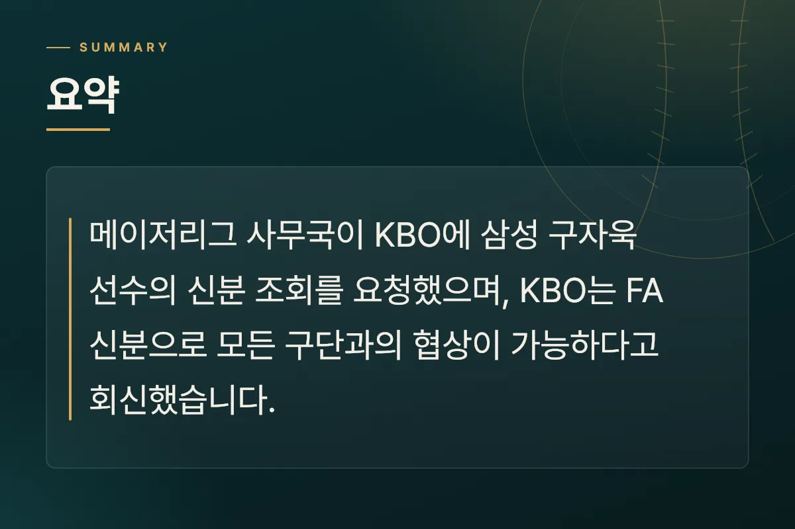

2026년 11월 21일 기준, 미국 메이저리그(MLB) 사무국이 한국야구위원회(KBO)에 삼성 라이온즈 소속 구자욱 선수에 대한 신분 조회를 요청한 사실이 공식 확인되었습니다. 연합뉴스, SBS, 엑스포츠뉴스 등 여러 언론 보도에 따르면 KBO는 지난 20일 메이저리그 사무국으로부터 구자욱 선수의 신분 조회 요청을 접수하였으며, 해당 선수가 자유계약선수(FA) 신분임을 통보했다고 밝혔습니다. 이번 조치는 해외 진출을 타진하거나 관심을 두는 선수에게 접촉하기 전 거치는 필수적인 행정 절차로, 구자욱 선수의 미국 무대 도전 가능성이 수면 위로 떠오르는 계기가 되고 있습니다.

<figure>

<figcaption>메이저리그 사무국 신분 조회 주요 항목과 구자욱 선수의 FA 신분 상태</figcaption>
</figure>

## 메이저리그 사무국의 신분 조회 요청 배경과 절차적 의미

한국야구위원회는 20일 공식 입장을 발표하고 메이저리그 사무국으로부터 삼성 구자욱에 대한 신분 조회 요청을 접수했다고 밝혔습니다. 프로야구 규정상 해외 구단이 KBO리그 소속 선수와 본격적인 협상이나 교류를 시작하기 위해서는 반드시 메이저리그 사무국을 거쳐 KBO에 선수의 정확한 계약 상태를 확인해야 합니다. 

뉴시스와 뉴스1 등 다수 언론 보도에 따르면, KBO는 메이저리그 사무국 측에 구자욱 선수가 프리에이전트(FA) 자격을 갖추고 있으며 국내외를 막론하고 모든 구단과 계약 체결이 가능한 신분이라는 점을 명확히 전달했습니다. 구자욱 선수는 지난 8일 종료된 한국시리즈 일정을 마친 뒤 FA 자격을 획득하였으며, KBO리그를 대표하는 정상급 타자로서 꾸준히 실력을 증명해 온 이력을 가지고 있습니다. 이러한 배경 속에서 메이저리그 사무국이 직접 신분 조회에 나서면서 야구팬들과 관계자들 사이에서 미국 진출설이 구체적인 현실로 다가오고 있습니다.

## 구자욱 선수의 FA 신분과 향후 협상 가능 범위

KBO의 공식 통보 내용에 따라 구자욱 선수는 제약 없이 국내 구단뿐만 아니라 해외 프로야구 구단까지 포함한 모든 구단과 자유롭게 협상 테이블을 차릴 수 있는 자격을 확보했습니다. 해외 진출을 염두에 두고 있는 선수에게 메이저리그 사무국의 신분 조회는 단순히 행정적 절차를 넘어, 미국 현지 구단들이 해당 선수를 향해 어느 정도의 관심을 갖고 있는지 가늠할 수 있는 중요한 지표로 여겨집니다.

한국일보 보도에 따르면 이번 오프시즌 'FA 최대어' 중 한 명으로 평가받는 구자욱 선수를 향해 메이저리그 사무국이 신분 조회를 진행함에 따라 향후 행보에 큰 관심이 쏠리고 있습니다. 다만 이번 신분 조회 요청이 곧바로 메이저리그 구단의 구체적인 영입 제안이나 최종 계약 체결을 의미하는 것은 아닙니다. 이는 어디까지나 선수의 정확한 계약 가능 상태를 확인하는 사전 단계의 행정 절차에 해당하며, 실제 협상 진전 여부는 향후 선수 측과 메이저리그 구단들 간의 교섭 과정에 따라 결정될 사안입니다.

<figure>

<figcaption>구자욱 선수 신분 조회와 계약 가능 여부에 대한 질답 정리</figcaption>
</figure>

## 구자욱은 어떤 선수인가

일간스포츠 보도(2026년 11월 9~10일)를 바탕으로 정리한 구자욱의 2026시즌과 통산 기록입니다.

| 항목 | 기록 |
| --- | --- |
| 2026시즌 | 타율 0.371, 생애 첫 타격왕 |
| 2026 한국시리즈 | 5경기 타율 0.500(20타수 10안타) 1홈런 6타점, 시리즈 MVP |
| 통산 타율 | 0.322 (3,000타석 이상 타자 중 역대 4위) |
| 통산 홈런 | 201개 |

구자욱은 2015년 데뷔 이후 12년 연속 세 자릿수 안타를 기록했고, 2026년 삼성의 12년 만의 한국시리즈 우승을 이끌었습니다. 2022년 2월 삼성과 맺은 **5년 최대 120억 원**(총연봉 90억 원, 옵션 30억 원)의 비FA 다년계약이 끝나면서 이번 겨울 FA 시장에 나왔습니다.

## 삼성이 붙잡으려면: 샐러리캡과 '래리버드 룰'

삼성은 구자욱과 에이스 원태인을 모두 잡아야 하는 상황이지만, 경쟁균형세(샐러리캡)가 부담입니다. 일간스포츠에 따르면 KBO에는 이른바 **'래리버드 룰'**이라 불리는 프랜차이즈 선수 예외 규정이 있습니다. 한 구단에서 **7시즌 이상** 뛴 선수 가운데 **1명**에 한해, 그 선수 연봉의 **50%**를 샐러리캡 계산에서 빼 주는 제도입니다. 두 선수 모두 삼성에서 7시즌 이상 뛰었지만 예외는 1명에게만 쓸 수 있어, 누구에게 먼저 쓸지가 삼성의 고민입니다.

## 변수: 메이저리그 직장폐쇄 가능성

메이저리그 진출을 생각한다면 미국 쪽 사정도 봐야 합니다. 세계일보 보도에 따르면 MLB의 현행 노사협약은 **미국 동부시간 12월 1일 오후 11시 59분**에 만료됩니다. 구단주들은 샐러리캡 도입을 필수 조건으로 내걸었고, 선수노조는 강하게 반대하고 있습니다.

새 협약 없이 구단주들이 직장폐쇄를 결정하면 **12월 2일부터 선수 계약, 트레이드, 구단과 선수의 공식 접촉이 모두 멈춥니다.** 겨울 FA 시장도 사실상 얼어붙습니다. 2021년 12월에도 직장폐쇄로 99일 동안 리그 운영이 멈췄던 전례가 있습니다. 세계일보는 직장폐쇄가 길어지면 미국 진출을 노리는 KBO 선수들의 계약 일정이 늦어질 수 있다고 짚었습니다.

## 자주 묻는 질문

**Q. 신분 조회 요청이 들어오면 반드시 메이저리그 구단과 계약하게 되나요?**

A. 신분 조회는 선수의 정확한 계약 가능 신분을 확인하는 기본적인 행정 절차일 뿐 계약 체결을 보장하지 않습니다. 다만 메이저리그 구단들이 해당 선수에게 관심을 갖고 영입 가능성을 검토하고 있음을 보여주는 신호로 해석됩니다.

**Q. 구자욱 선수는 현재 어떤 프로야구 구단들과 협상할 수 있나요?**

A. KBO의 공식 통보 내용에 따르면 구자욱 선수는 FA 신분이므로 국내 프로야구 구단뿐만 아니라 해외 구단을 포함한 모든 구단과 자유롭게 만나 협상하고 계약을 체결할 수 있습니다.

**Q. 이번 신분 조회를 공식적으로 요청한 기관은 어디인가요?**

A. 한국야구위원회에 따르면 미국 메이저리그 사무국이 공식적으로 삼성 구자욱 선수에 대한 신분 조회를 요청한 것으로 확인되었습니다.

<figure>

<figcaption>메이저리그 사무국의 구자욱 선수 신분 조회 요청과 향후 협상 자격에 대한 요약</figcaption>
</figure>

**Q. 메이저리그가 직장폐쇄에 들어가면 구자욱 협상은 어떻게 되나요?**

A. 세계일보 보도 기준으로 직장폐쇄가 시작되면 MLB 구단과 선수 사이의 계약과 공식 접촉이 중단됩니다. 그 기간에는 메이저리그 구단과의 계약 진행이 멈추게 되며, 국내 구단과의 협상은 이와 별개로 진행할 수 있습니다.

## 참고한 자료

- [초읽기 들어간 메이저리그 직장폐쇄…2027시즌 열릴 수 있을까 송용준...](https://www.segye.com/newsView/20261120508846?OutUrl=naver) — segye.com, 2026-11-21 보도
- [[IS 이슈] "양의지 152억 깬다" KS 우승에 MVP까지…타격왕 구자욱, FA 역대 최고액 정조준](https://isplus.com/article/view/isp202611090034) — 일간스포츠, 2026-11-09 보도
- ['푸른 새 시대' 열려면 붙잡아야 한다…삼성의 고민, 구자욱·원태인과 샐러리캡](https://isplus.com/article/view/isp202611100050) — 일간스포츠, 2026-11-10 보도
- [‘대박’ 노시환, 메이저리그 홈페이지에 이름 떴다…FA 3루수 부문에 소...](https://mhnse.com/news/articleView.html?idxno=1704398) — mhnse.com, 2026-11-21 보도
- [구자욱, 미국 진출 현실화? MLB '신분 조회 요청'](https://news.sbs.co.kr/news/endPage.do?news_id=N1008856394&plink=ORI&cooper=NAVER) — SBS, 2026-11-20 보도
- [오피셜 구자욱, ML 신분조회 들어왔다!…"그는 FA입니다, 모두와 협상...](https://www.xportsnews.com/article/2221550) — 엑스포츠뉴스, 2026-11-20 보도
- [빅리그 노리는 구자욱…MLB 사무국, 신분 조회 요청](https://www.yna.co.kr/view/AKR20261120144000007?input=1195m) — 연합뉴스, 2026-11-20 보도
- [MLB 사무국, 삼성 '우승 주장' 구자욱 신분조회 요청](https://www.newsis.com/view/NISX20261120_0003877133) — 뉴시스, 2026-11-20 보도

2026년 11월 21일 기준으로 정리했습니다. 일정이나 금액처럼 바뀔 수 있는 내용은 위 참고 자료에서 한 번 더 확인해 주세요.
