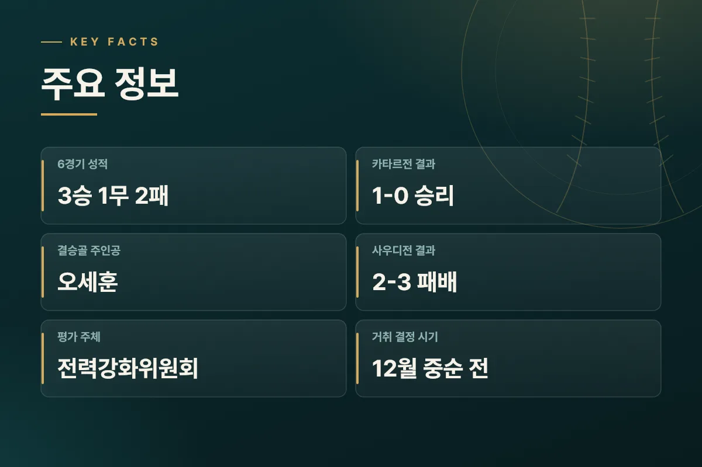
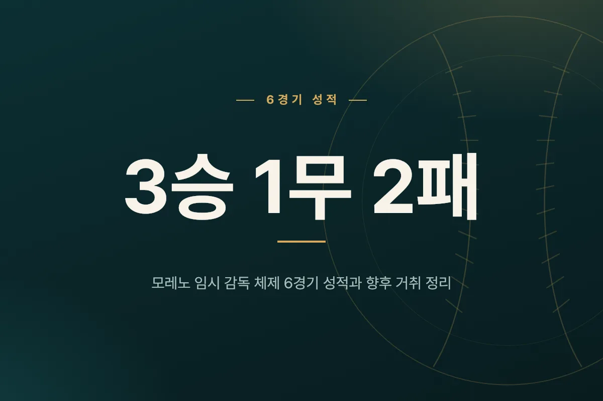
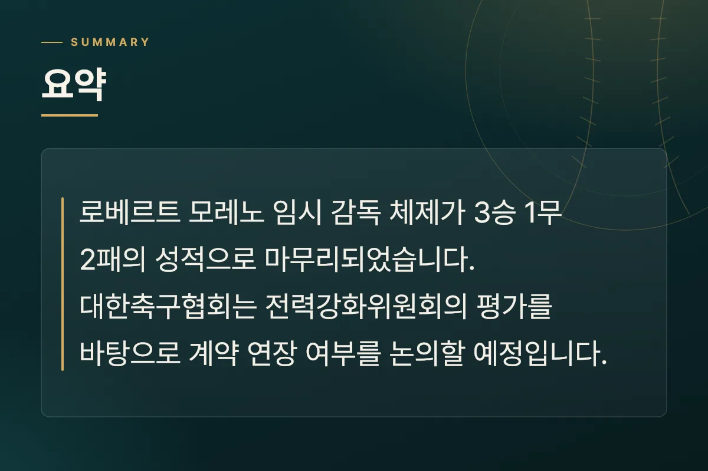
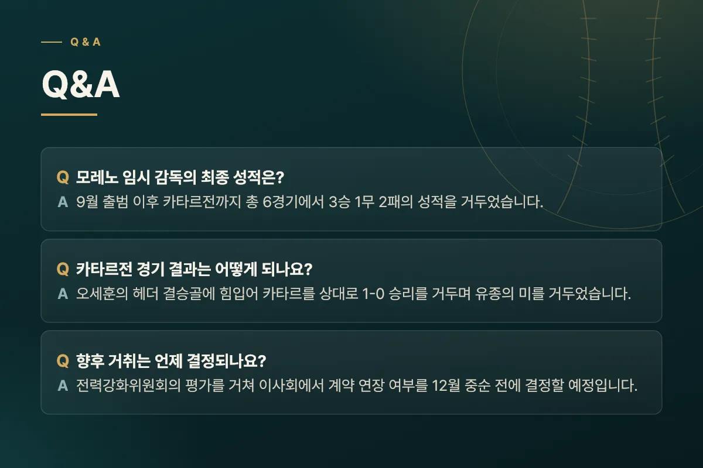
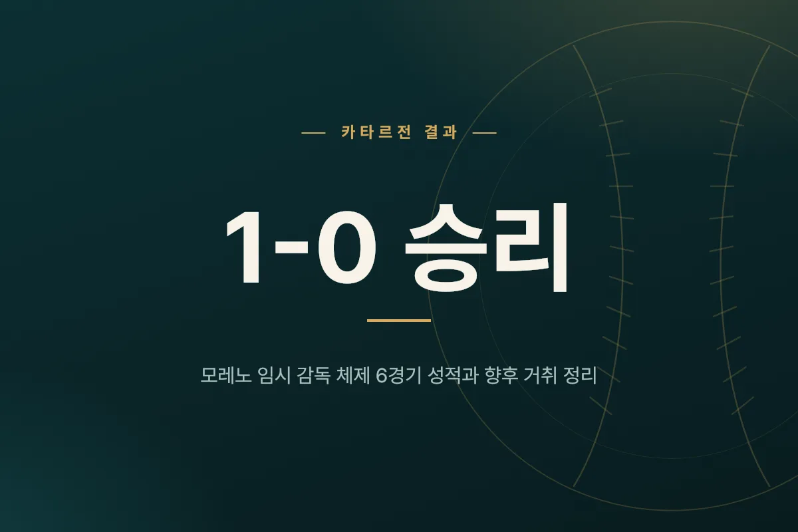
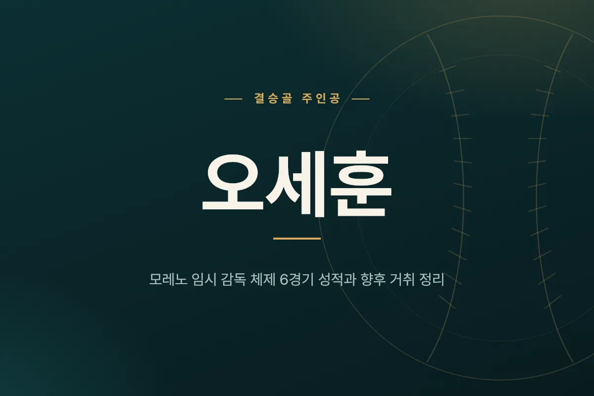

2026년 11월 18일 기준으로 로베르트 모레노 임시 감독이 이끈 축구 대표팀의 A매치 일정이 카타르전을 끝으로 마무리되었습니다. 연합뉴스 등의 주요 언론 보도에 따르면, 대표팀은 지난 17일 카타르 도하의 압둘라 빈 칼리파 스타디움에서 열린 경기에서 오세훈의 결승골에 힘입어 1-0으로 승리했습니다. 이로써 지난 9월 출범한 로베르트 모레노 임시 감독 체제는 총 6경기 동안 3승 1무 2패의 성적표를 남기며 공식 일정을 마감하게 되었습니다.

<figure>

<figcaption>모레노 임시 감독 체제의 6경기 성적 요약</figcaption>
</figure>

### 모레노 임시 감독 체제 6경기의 성과와 경기 내용 분석

지난 2026 북중미 월드컵에서 32강 진출이 좌절된 이후 대표팀은 어수선한 분위기를 수습해야 하는 무거운 과제를 안고 출발했습니다. 로베르트 모레노 임시 감독은 9월과 10월에 걸쳐 A매치 4연전을 소화했고, 이어서 11월 A매치 2연전까지 총 6경기를 직접 지휘했습니다. 

전체적인 성적표는 3승 1무 2패로 집계되었으나, 그 과정을 들여다보면 보완해야 할 점도 뚜렷하게 드러났습니다. 뉴시스 보도에 따르면 안방에서 치러진 우루과이전에서는 수비가 흔들리며 1-4로 크게 패했고, 사우디아라비아와의 경기에서는 무려 42년 만에 3실점을 허용하며 2-3으로 무너지는 아픔을 겪었습니다. 그렇지만 마지막 경기로 치러진 카타르전에서는 집중력을 발휘해 오세훈의 헤더 결승골을 끝까지 지켜내며 유종의 미를 거둘 수 있었습니다.

<figure>

<figcaption>모레노 임시 감독 체제의 주요 경기 결과</figcaption>
</figure>

### 향후 거취와 대한축구협회의 평가 및 결정 절차

스포츠한국과 한겨레 등 보도에 따르면, 로베르트 모레노 임시 감독과 대한축구협회의 2개월 간의 동행은 일단락되었습니다. 이제 축구 팬들의 시선은 대한축구협회가 내릴 최종 결정에 집중되고 있습니다. 당초 내년 1월로 예정되었던 아시아축구협회 관련 일정 등이 변수로 작용하면서 거취 발표 시점에 대한 관심도 더욱 높아졌습니다.

동아일보 보도에 따르면, 축구협회 전력강화위원회는 로베르트 모레노 임시 감독 체제에서 치른 6경기의 내용을 바탕으로 면밀한 평가 작업을 진행하고 있습니다. 이 평가 결과가 나오면 곧바로 이사회에 통보되며, 최종적으로 이사회가 모레노 감독의 계약 연장 여부나 새로운 사령탑 선임 여부를 결정하는 절차를 밟게 됩니다. 뉴스1 보도에 따르면 관련 논의와 평가는 12월 중순 전에 이뤄질 것으로 전망되고 있습니다.

<figure>

<figcaption>대한축구협회 평가 일정 안내</figcaption>
</figure>

### 모레노 감독의 소회와 한국 축구대표팀이 마주한 과제

SBS와 연합뉴스 보도를 통해 전해진 로베르트 모레노 감독의 발언을 보면, 그는 마지막 경기를 마친 뒤 "결국 시간과 신뢰가 중요하며, 대표팀을 다시 맡을 가능성에 대해서도 당연히 생각하고 있다"는 입장을 밝혔습니다. 임시 사령탑이라는 제한된 신분과 짧은 기간 속에서도 팀을 다잡기 위해 기울인 노력이 어느 정도 반영된 소회로 읽힙니다.

하지만 한국 축구대표팀이 마주한 현실은 단순한 임시 감독의 연임 여부 그 이상을 요구하고 있습니다. 월드컵 이후 추락한 대표팀의 국제 경쟁력을 근본적으로 되찾고, 향후 몇 년을 내다보는 장기적인 청사진을 마련해야 하는 시점입니다. 뉴스1은 축구협회가 이제는 흔들리지 않는 분명한 기준과 책임 있는 판단을 내려야 한다고 지적했습니다.

<figure>

<figcaption>모레노 감독의 소회와 향후 과제</figcaption>
</figure>

### 모레노 감독은 누구인가

일간스포츠가 전한 대한축구협회 발표에 따르면 로베르트 모레노 감독은 스페인 출신으로, 2014년부터 2017년까지 FC 바르셀로나 수석코치, 2018~2019년 스페인 대표팀 수석코치와 감독을 지냈습니다. 가장 최근에는 2024~25시즌 러시아 FC 소치를 이끌었습니다. 데이터를 활용한 전술 설계와 상대 분석이 강점으로 꼽힙니다. 코치진도 소치에서 함께한 에두아르도 도캄포 수석코치 등 모두 스페인 출신으로 꾸렸습니다.

### 어떻게 선임됐나

대한축구협회는 2026년 7월 말 이사회에서 9~11월 A매치 6경기를 맡을 임시 감독을 대한체육회 규정에 따른 **공개채용** 방식으로 뽑기로 했습니다. 서류 평가, 온라인 면접, 대면 미팅을 거쳐 **9월 1일 제7차 이사회**에서 모레노 감독과 코칭스태프 선임을 승인했습니다. 계약에는 6경기 평가 후 연장해 아시안컵까지 맡을 수 있는 조건이 들어간 것으로 알려졌습니다.

### 아시안컵 일정이 미뤄졌다

톱스타뉴스 보도에 따르면 아시아축구연맹(AFC)은 중동 정세에 따른 물류·이동 차질을 이유로, 원래 **2027년 1월 7일~2월 5일** 사우디아라비아에서 열릴 예정이던 아시안컵을 **2027년 12월 23일~2028년 1월 21일**로 미루기로 했습니다. 변경 일정은 FIFA 승인 절차가 남아 있습니다.

아시안컵이 1년 가까이 늦춰지면서, 임시 감독에게 대회까지 맡긴다는 처음 구상의 전제가 바뀌었습니다. 모레노 감독은 카타르전 뒤 "나는 27일까지 계약된 만큼 지금으로선 내가 할 수 있는 게 없다"며 "6경기를 치르는 동안 행복했고 한국 대표팀 지휘봉을 맡을 수 있어서 영광이었다"고 말했습니다.

## 자주 묻는 질문

**모레노 임시 감독 체제의 6경기 최종 성적은 어떻게 되나요?**

로베르트 모레노 임시 감독 체제에서 치른 총 6경기의 성적은 3승 1무 2패입니다. 9월 출범 이후 11월 카타르전까지 치르며 임시 일정을 마무리했습니다.

**우루과이전과 사우디아라비아전의 구체적인 결과는 어땠나요?**

안방에서 치러진 우루과이전에서는 1-4로 크게 패했으며, 사우디아라비아전에서는 42년 만에 3실점을 허용하며 2-3으로 패배했습니다.

**카타르전 경기 결과와 득점 기록은 어떻게 되나요?**

카타르 도하에서 열린 마지막 평가전에서 한국은 전반 또는 후반 공방 끝에 터진 오세훈의 결승 헤더골을 끝까지 잘 지켜내며 1-0 승리를 거뒀습니다.

**대한축구협회의 향후 거취 결정은 어떤 절차로 진행되나요?**

전력강화위원회가 6경기의 경기력을 평가해 이사회에 통보하며, 이후 12월 중순 전에 계약 연장 여부가 최종적으로 결정될 예정입니다.

**모레노 감독은 자신의 향후 거취에 대해 어떤 입장을 밝혔나요?**

모레노 감독은 마지막 경기 후 인터뷰에서 시간과 신뢰의 중요성을 언급하며, 대표팀 지휘봉을 다시 잡을 가능성에 대해 당연히 고려하고 있다고 밝혔습니다.

<figure>

<figcaption>카타르전 결과: 1-0 승리</figcaption>
</figure>

### 대표팀의 향후 전망과 남겨진 방향성

로베르트 모레노 임시 체제가 남긴 3승 1무 2패라는 기록은 절반의 성공이라는 평가와 함께 명확한 한계를 동시에 보여주었습니다. 대한축구협회가 전력강화위원회의 객관적인 평가를 토대로 어떤 선택을 내릴지에 따라 한국 축구의 향후 행보와 경쟁력이 크게 달라질 것으로 보입니다. 단기적인 경기 결과에만 연연하기보다는 장기적인 관점에서 한국 축구의 올바른 방향성을 세워야 한다는 목소리가 더욱 힘을 얻고 있습니다.

<figure>

<figcaption>결승골 주인공: 오세훈</figcaption>
</figure>

## 참고한 자료
- [[오피셜] KFA 모레노 감독 임시 감독으로 선임... 11월까지 6경기 이끈다](https://isplus.com/article/view/isp202609010102) — 일간스포츠, 2026-09-01 보도
- [[리부트] 홍명보 사퇴 후 '임시' 감독 모레노, 6경기 3승 1무 2패…지휘봉 어디로?](https://www.topstarnews.net/news/articleView.html?idxno=16279595) — 톱스타뉴스, 2026-11-18 보도

- [모레노호, 카타르 꺾고 올해 A매치 유종의 미…오세훈 결승골(종합)](https://www.newsis.com/view/NISX20261118_0003872308) — 뉴시스, 2026-11-18 보도
- ['임시감독' 모레노와 동행 이어갈까…KFA "27일 전에 평가·12월 중순 발...](https://sports.hankooki.com/news/articleView.html?idxno=6943802) — sports.hankooki.com, 2026-11-18 보도
- [손흥민 왕따설에 휘말렸던 이강인 공식 입장 "밖에서 벌어지는 일은 통...](https://www.spotvnews.co.kr/news/articleView.html?idxno=1020621) — spotvnews.co.kr, 2026-11-18 보도
- [카타르전 승리했지만 ‘절반의 성공’…모레노 임시 감독 운명은?](https://www.donga.com/news/Sports/article/all/20261118/135046100/1) — 동아일보, 2026-11-18 보도
- [마지막 평가전서 웃은 모레노호…한국, 카타르에 1-0 승](https://www.hani.co.kr/arti/sports/soccer/1287843.html) — 한겨레, 2026-11-18 보도
- ['오세훈 헤더골' 모레노호, 카타르 꺾고 올해 A매치 '유종의 미'](https://www.edaily.co.kr/News/Read?newsId=01102086645647032&mediaCodeNo=257&utm_source=naver&utm_medium=referral&utm_campaign=news_syndication&utm_content=original_article) — 이데일리, 2026-11-18 보도

2026년 11월 18일 기준으로 정리했습니다. 일정이나 금액처럼 바뀔 수 있는 내용은 위 참고 자료에서 한 번 더 확인해 주세요.
