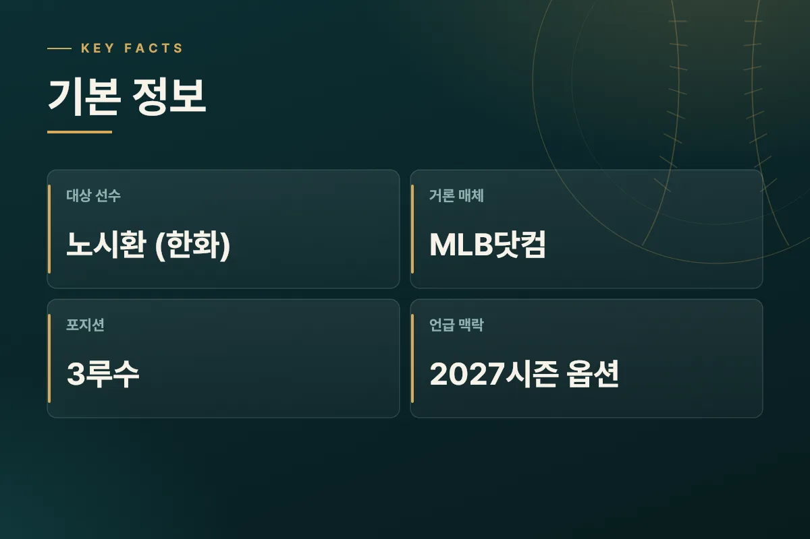
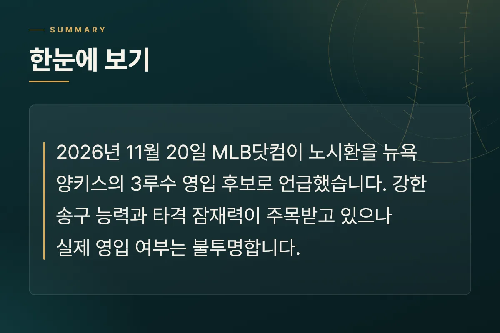
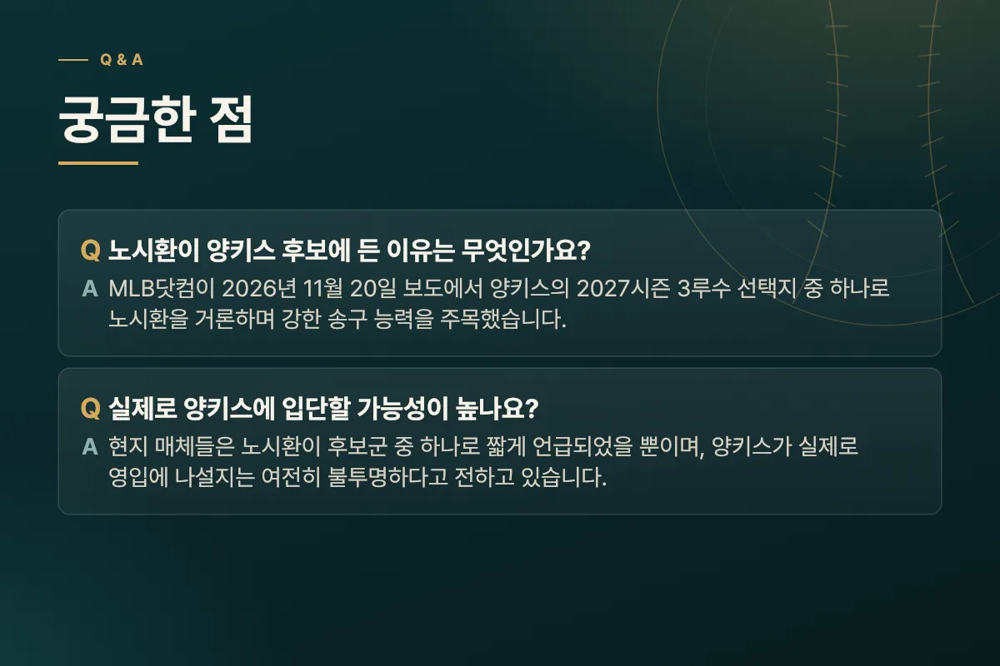

2026년 11월 20일 기준, 메이저리그 공식 홈페이지인 MLB닷컴이 한화 이글스의 노시환을 뉴욕 양키스의 2027시즌 주전 3루수 후보군 중 하나로 언급하면서 야구 팬들과 언론의 이목이 집중되고 있습니다. 빅리그 진출을 선언한 노시환을 향해 미국 현지 매체들이 어떤 배경에서 이름을 올렸으며, 스토브리그에서 실제 양키스 유니폼을 입을 가능성이 어느 정도인지 여러 보도를 바탕으로 자세히 살펴봅니다.

<figure>

<figcaption>노시환의 메이저리그 진출 가능성과 현지 평가를 다룬 보도 화면</figcaption>
</figure>

## MLB닷컴이 주목한 노시환, 양키스 3루수 후보로 거론된 배경

뉴시스, stoo.com, 일간스포츠 등 국내 다수 매체의 2026년 11월 20일 보도에 따르면, 메이저리그 공식 홈페이지 MLB닷컴은 양키스의 2027시즌 3루수 옵션을 전망하는 과정에서 노시환의 이름을 올렸습니다. 스토브리그 기간 동안 핫코너 전략의 향상을 도모하는 양키스가 눈여겨볼 수 있는 선택지 중 하나로 꼽힌 것입니다. 

동아일보의 같은 날 보도에서는 노시환이 크로포드, 재즈 치좀 주니어, 에우제니오 수아레즈와 같은 선수들과 함께 양키스 3루수 후보로 나란히 거론되었다고 전했습니다. 다만 당시 매체들의 보도를 면밀히 살펴보면 구체적인 계약 조건이나 협상 진척 상황에 대한 깊이 있는 설명보다는 후보군 중 한 명으로서 짧게 이름이 오르내린 수준에 가깝습니다. 대형 스토브리그 시장에서 여러 구단들이 다양한 가능성을 열어두고 후보를 물색하는 과정의 일환으로 해석할 수 있습니다.

## 현지 언론이 바라보는 장점과 우려 섞인 시선

mydaily.co.kr과 starnewskorea.com 등 여러 매체의 보도 내용을 살펴보면, 미국 현지에서는 노시환의 타격 능력과 송구 어깨에 대해 긍정적인 평가를 내리면서도 수비 전반에 대해서는 물음표를 달고 있습니다. MLB닷컴은 노시환이 최근 4시즌 동안 최상위 타자로서 보여준 역량과 함께 강한 송구 능력을 갖추고 있다고 언급했습니다. 

반면 수비력 자체에 대해서는 다소 아쉬움이 남을 수 있다는 평가도 함께 제기되는 모습입니다. mhnse.com의 11월 18일 보도에서도 노시환이 기록한 홈런 기록 등 장타력 보강 측면에서는 매력적인 카드이지만 수비 안정성에 대해서는 미국 언론 내에서도 엇갈린 시선이 존재한다고 분석한 바 있습니다. 테루아키나 알렉 봄 같은 다른 후보들과 비교할 때 노시환만의 강점이 메이저리그 무대에서 확실히 통할지에 대한 분석이 이어지는 이유입니다.

<figure>

<figcaption>미국 언론이 분석한 노시환의 장단점과 평가 내용</figcaption>
</figure>

## 실제 이적 가능성과 앞으로 남은 과제

스포츠조선과 fnnews.com 등 앞선 보도들을 종합하면, 양키스를 비롯해 메츠, 필라델피아, 샌디에이고, 토론토 등 여러 메이저리그 구단들이 스토브리그에서 내야 보강을 위해 다양한 선수들을 저울질하고 있는 상황입니다. 양키스가 노시환을 3루수 후보로 언급한 것은 사실이지만, 이것이 곧바로 구체적인 영입 제안이나 계약 임박으로 이어진 것은 아닙니다.

엑스포츠뉴스의 11월 20일 보도에서도 양키스가 실제로 노시환 영입전에 본격적으로 뛰어들지는 여전히 불투명하다고 지적하고 있습니다. 여러 후보를 다각도로 검토하는 스토브리그 특유의 탐색전 양상 속에서 이름이 거론된 만큼, 향후 공식적인 접촉이나 구단 실사 과정 등이 어떻게 진행되는지 차분히 지켜볼 필요가 있습니다.

<figure>

<figcaption>노시환 이적설 관련 자주 묻는 질문과 답변</figcaption>
</figure>

## 노시환은 어떤 선수인가

일간스포츠가 전한 KBO 발표 기준 기록입니다.

| 항목 | 기록 |
| --- | --- |
| 데뷔 | 2019년 (한화 이글스) |
| 통산 홈런 | 153개 |
| 2026시즌 | 127경기 타율 0.283, 29홈런, 96타점 |
| 2026시즌 OPS | 0.865 (출루율 0.360, 장타율 0.505) |

스포츠경향에 따르면 2025시즌에는 타율 0.260, 32홈런, 101타점(OPS 0.851)을 기록했습니다. 2년 연속 30홈런 안팎을 친 장타력이 메이저리그 스카우트들이 주목하는 이유입니다.

## 포스팅은 어떻게 진행되나

KBO는 2026년 10월 31일 한화의 요청에 따라 MLB 사무국에 노시환의 포스팅(비공개 경쟁입찰)을 요청했다고 밝혔습니다.

- **협상 기간:** MLB 사무국이 포스팅을 고지한 다음 날 오전 8시(미국 동부시간)부터 **30일째 되는 날 오후 5시**까지 30개 구단 모두와 협상할 수 있습니다.
- **이적료:** 계약이 성사되면 영입 구단은 한미 선수계약협정에 따른 이적료를 한화에 지급합니다.
- **무산되면:** 기간 안에 계약하지 못하면 포스팅이 끝나고, **다음 해 11월 1일까지 다시 포스팅될 수 없습니다.**

## 한화와의 '11년 307억' 계약은 어떻게 되나

노시환은 2026년 2월 한화와 **11년 최대 307억 원**의 비FA 다년계약을 맺었습니다. KBO 역대 최장 기간·최대 규모 계약으로, 2027년부터 2037년까지 적용됩니다(스포츠경향 보도). 이 계약에는 2026시즌 뒤 포스팅으로 메이저리그에 도전할 수 있는 조항이 들어 있었습니다.

- 해외 진출은 **메이저리그로만** 제한됩니다.
- 메이저리그 진출에 성공하면 이 계약은 **무효**가 되고, 나중에 KBO로 돌아올 때는 **한화로만** 복귀해 새 계약을 맺습니다.
- 포스팅이 무산되면 307억 원 계약이 그대로 유지됩니다.

노시환은 계약 당시 "선수라면 누구나 세계 최고 무대에서 뛰는 것이 꿈"이라며 도전 의지를 밝혔습니다.

## 자주 묻는 질문

**노시환이 양키스 3루수 후보로 언급된 이유는 무엇인가요?**

메이저리그 공식 홈페이지 MLB닷컴은 2026년 11월 20일 보도를 통해 양키스의 2027시즌 3루수 선택지 중 하나로 노시환을 거론하며 그의 강한 송구 능력을 주목했습니다. 현지 매체들은 그가 최근 4시즌 동안 보여준 타격 역량과 송구 어깨를 긍정적으로 평가했습니다.

**실제로 뉴욕 양키스로 이적할 가능성이 높나요?**

MLB닷컴은 노시환을 후보군 중 하나로 짧게 언급했을 뿐이며, 양키스가 실제로 영입에 나설지는 여전히 불투명하다는 시각이 지배적입니다. 여러 메이저리그 구단들이 다양한 선수를 저울질하는 탐색전 단계이므로 구체적인 진척 상황은 더 지켜봐야 합니다.

<figure>

<figcaption>대상 선수: 노시환 (한화)</figcaption>
</figure>

## 참고한 자료

- [[오피셜] 한화와 307억 계약한 노시환, MLB 도전…KBO 포스팅 요청](https://isplus.com/article/view/isp202610310023) — 일간스포츠, 2026-10-31 보도
- [또 해외진출 열어놓은 다년계약…'11년 307억' KBO 사상 초유 계약도 1년 뒤 '없던 일' 될 수 있다?](https://sports.khan.co.kr/article/202602231712003) — 스포츠경향, 2026-02-23 보도
- ['한화 307억 포기' 노시환 초대박! 뉴욕이 부른다? 양키스 영입 후보 등...](https://www.xportsnews.com/article/2221494) — 엑스포츠뉴스, 2026-11-20 보도
- [MLB닷컴, 양키스 3루수 후보에 노시환 언급…"송구 능력 갖춰"](https://www.newsis.com/view/NISX20261120_0003876285) — 뉴시스, 2026-11-20 보도
- [엠엘비닷컴, 양키스 3루수 후보로 노시환 언급…"송구 능력 갖춰"](http://www.stoo.com/article.php?aid=110004217054) — stoo.com, 2026-11-20 보도
- [“수비 조금 약하지만…송구능력 있다” 노시환 양키스 주전 3루수 후보...](https://www.mydaily.co.kr/page/view/2026112013121212769) — mydaily.co.kr, 2026-11-20 보도
- ["최근 4시즌 최상위 타자+수비 약하지만 어깨 강해"...노시환, 뉴욕 양키...](https://isplus.com/article/view/isp202611200046) — 일간스포츠, 2026-11-20 보도
- [‘다가오는 마감 시한’ 노시환, ML 진출 성공? ‘NYY 3루수 후보’ 언급](https://sports.donga.com/sports/article/all/20261120/135058632/1) — 동아일보, 2026-11-20 보도

2026년 11월 20일 기준으로 정리했습니다. 일정이나 금액처럼 바뀔 수 있는 내용은 위 참고 자료에서 한 번 더 확인해 주세요.
