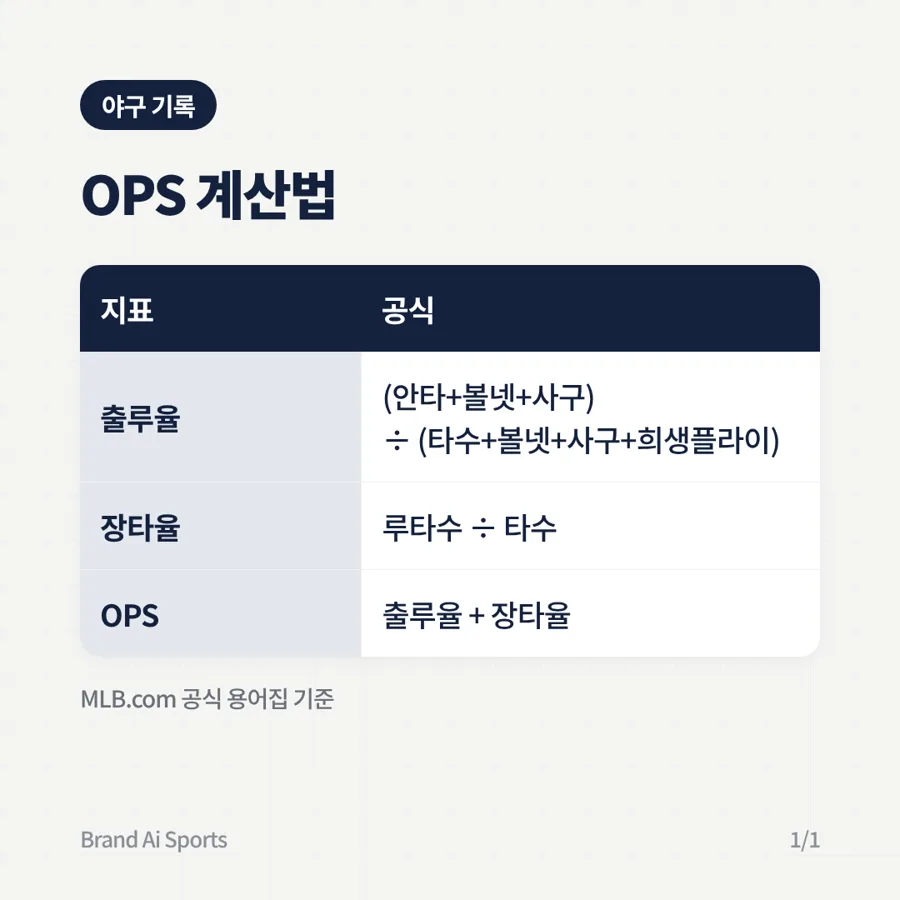

OPS(On-base Plus Slugging)는 **출루율과 장타율을 더한 값**으로, 타자가 얼마나 자주 살아 나가는지와 얼마나 멀리 치는지를 한 숫자로 보여 주는 지표입니다. MLB 공식 용어집은 OPS를 "출루율과 장타율을 더해 두 능력을 하나로 묶은 수치"라고 설명합니다. KBO 기록실도 OPS를 타자 부문 순위로 보여 줍니다.

## OPS 계산 공식

| 지표 | 공식 |
| --- | --- |
| 출루율(OBP) | (안타 + 볼넷 + 몸에 맞는 공) ÷ (타수 + 볼넷 + 몸에 맞는 공 + 희생플라이) |
| 장타율(SLG) | (1루타 + 2루타×2 + 3루타×3 + 홈런×4) ÷ 타수 |
| OPS | 출루율 + 장타율 |

출루율 공식은 일간스포츠 칼럼이 설명한 현재 공식(분자 안타+4사구, 분모 타수+4사구+희생플라이)과 같습니다. MLB 용어집에 따르면 실책이나 야수 선택으로 나간 경우는 출루로 치지 않고, 희생번트는 감독의 작전인 경우가 많아 계산에서 아예 뺍니다.

장타율 공식은 MLB 용어집에 나온 (1B + 2B×2 + 3B×3 + HR×4) ÷ AB 그대로입니다. 장타율은 안타만 다루고 볼넷과 몸에 맞는 공은 넣지 않는다는 점이 출루율과 다릅니다.

## 계산 예시

타수 500, 안타 150(1루타 100, 2루타 30, 3루타 5, 홈런 15), 볼넷 60, 몸에 맞는 공 5, 희생플라이 5인 타자를 예로 들면 다음과 같습니다.

1. **출루율:** (150 + 60 + 5) ÷ (500 + 60 + 5 + 5) = 215 ÷ 570 ≈ 0.377
2. **루타수:** 100 + 30×2 + 5×3 + 15×4 = 100 + 60 + 15 + 60 = 235
3. **장타율:** 235 ÷ 500 = 0.470
4. **OPS:** 0.377 + 0.470 = 0.847

이 타자의 타율은 150 ÷ 500 = 0.300입니다. 같은 타율 3할이라도 볼넷을 더 많이 고르거나 장타가 많으면 OPS는 훨씬 높아집니다.

## 타율과 OPS는 무엇이 다른가

MLB 용어집은 타율이 모든 안타를 똑같이 취급하는 반면, 장타율은 2루타·3루타·홈런에 더 큰 값을 준다고 설명합니다. 출루율은 볼넷과 몸에 맞는 공까지 포함해 "아웃되지 않고 나간 비율"을 봅니다.

그래서 타율만 보면 놓치는 것이 두 가지입니다.

- **볼넷을 잘 고르는 타자:** 타율은 평범해도 출루율이 높아 팀에 기회를 많이 만듭니다.
- **장타형 타자:** 안타 수가 같아도 홈런과 2루타가 많으면 득점에 더 크게 기여합니다.

OPS는 이 두 능력을 한 숫자에 담아, 타자를 빠르게 비교할 때 쓰기 좋습니다.

## 출루율의 역사, 한국이 더 빨랐다

일간스포츠 칼럼에 따르면 출루율은 1954년 브루클린 다저스 단장 브랜치 리키와 통계 전문가 앨런 로스가 처음 발표했습니다. MLB에서 출루율이 공식 통계가 된 것은 1984년입니다. 반면 KBO는 원년인 1982년 시즌이 끝난 뒤 이사회에서 출루율을 공식 시상 항목에 넣었습니다.

## OPS의 한계와 OPS+

OPS는 계산이 쉬운 대신 두 가지 한계가 있습니다.

1. **출루율과 장타율을 1:1로 더한다:** 두 지표는 계산 방식과 숫자 범위가 다른데, OPS는 이를 같은 비중으로 단순히 더한 값입니다.
2. **구장과 리그 환경을 반영하지 않는다:** MLB 용어집은 OPS가 홈구장 크기 같은 요인의 영향을 알려 주지 않는다고 설명합니다.

이를 보완한 지표가 **OPS+**입니다. MLB 용어집에 따르면 OPS+는 리그 평균과 구장 요인을 반영해 조정한 값으로, 공식은 100 × (출루율/리그 출루율 + 장타율/리그 장타율 − 1)이고 이후 구장 보정을 합니다. 100이 리그 평균이며, 150이면 평균보다 50% 뛰어난 타자라는 뜻입니다.

## OPS를 볼 때 판단 기준

이 글에서 권하는 읽는 법은 세 단계입니다.

1. **OPS로 큰 그림:** 타자를 한 줄로 세울 때 먼저 봅니다.
2. **출루율·장타율로 성격:** 같은 OPS라도 출루율이 높은지 장타율이 높은지로 타자 유형을 나눕니다.
3. **OPS+로 비교:** 다른 시즌이나 다른 리그 선수를 비교할 때는 리그·구장 보정이 된 OPS+를 씁니다.

KBO의 다른 규정이 궁금하다면 [KBO FA 등급제 정리](/p/kbo-fa-grade-compensation-rules/)와 [KBO 피치클락 규칙](/p/kbo-pitch-clock-rules-2026/)도 함께 보세요.

## 자주 묻는 질문

**OPS는 무엇의 약자인가요?**

On-base Plus Slugging의 약자로, 출루율(On-base Percentage)과 장타율(Slugging Percentage)을 더한 값입니다.

**OPS는 어떻게 계산하나요?**

출루율과 장타율을 더하면 됩니다. 출루율은 (안타+볼넷+몸에 맞는 공)을 (타수+볼넷+몸에 맞는 공+희생플라이)로 나누고, 장타율은 루타수를 타수로 나눕니다.

**장타율이 1을 넘을 수도 있나요?**

넘을 수 있습니다. 장타율은 루타수를 타수로 나누는데, 홈런은 4루타로 계산되므로 장타가 아주 많으면 1.000을 넘습니다.

**OPS와 OPS+는 무엇이 다른가요?**

OPS는 단순 합계이고, OPS+는 리그 평균과 구장 요인을 반영해 100을 평균으로 맞춘 값입니다.

**희생번트는 출루율에 들어가나요?**

들어가지 않습니다. MLB 용어집에 따르면 희생번트는 감독의 작전인 경우가 많아 출루율 계산에서 아예 제외합니다. 희생플라이는 분모에 들어갑니다.

## 핵심 요약

- OPS는 출루율과 장타율을 더한 타격 지표로, MLB 공식 용어집은 타자가 출루하는 능력과 장타를 치는 능력을 하나로 묶은 수치라고 설명합니다.
- 출루율은 (안타+볼넷+몸에 맞는 공)÷(타수+볼넷+몸에 맞는 공+희생플라이), 장타율은 (1루타+2루타×2+3루타×3+홈런×4)÷타수로 계산합니다.
- OPS+는 리그 평균과 구장 요인을 반영해 100을 리그 평균으로 맞춘 지표로, 다른 시즌이나 리그의 타자를 비교할 때 OPS보다 공정합니다.

## 참고한 자료

- [On-base Plus Slugging (OPS)](https://www.mlb.com/glossary/standard-stats/on-base-plus-slugging) — MLB.com 공식 용어집, 확인일 2026-11-27
- [On-base Percentage (OBP)](https://www.mlb.com/glossary/standard-stats/on-base-percentage) — MLB.com 공식 용어집, 확인일 2026-11-27
- [Slugging Percentage (SLG)](https://www.mlb.com/glossary/standard-stats/slugging-percentage) — MLB.com 공식 용어집, 확인일 2026-11-27
- [Adjusted OPS (OPS+)](https://www.mlb.com/glossary/advanced-stats/on-base-plus-slugging-plus) — MLB.com 공식 용어집, 확인일 2026-11-27
- [출루율, 그리고 선구자 박기철](https://isplus.com/article/view/isp201604120021) — 일간스포츠, 2016-04-12, 확인일 2026-11-27
- [KBO 기록실 TOP5](https://www.koreabaseball.com/record/ranking/top5.aspx) — KBO, 확인일 2026-11-27
- 사진 일부: Pixabay (무료 이용 허가 이미지)

정보 기준일: 2026-11-27. 리그별 세부 기록 규칙은 KBO와 MLB 공식 규정을 함께 확인하세요.
