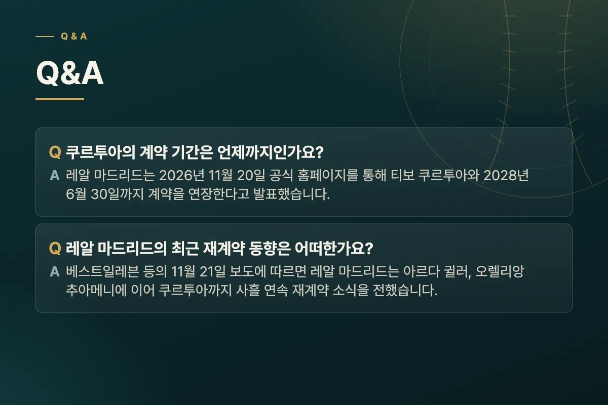
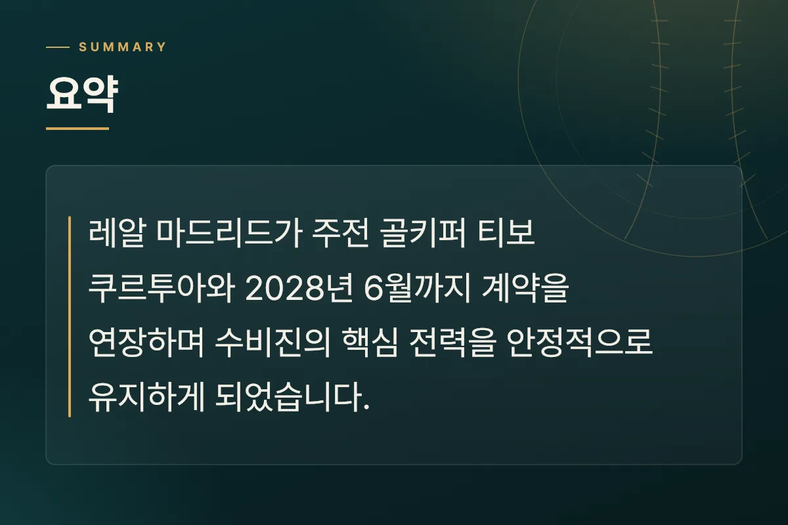

2026년 11월 21일 기준, 레알 마드리드 CF가 세계 정상급 골키퍼 티보 쿠르투아와의 동행을 연장하는 계약을 공식 발표했습니다. 이번 재계약으로 티보 쿠르투아는 2028년 6월 30일까지 산티아고 베르나베우에 머물며 팀의 골문을 든든하게 지키게 되었습니다.

<figure>

<figcaption>Q&amp;A</figcaption>
</figure>

## 레알 마드리드 뒷문 강화와 티보 쿠르투아의 계약 배경

레알 마드리드 구단은 2026년 11월 20일 공식 홈페이지와 미디어를 통해 티보 쿠르투아와의 계약 연장 합의 소식을 대중에 알렸습니다. 스포츠 전문 매체 스포티비뉴스 등의 11월 20일 보도에 따르면, 세계 최고 수준의 골키퍼로 평가받는 티보 쿠르투아는 기존 계약 만료를 앞두고 구단과 심도 있는 협상을 마무리 지었습니다. 유럽 축구 이적시장 전문가로 잘 알려진 파브리지오 로마노 역시 사회관계망서비스 등을 통해 해당 계약 성사 소식을 사전에 전하며 전 세계 축구 팬들의 이목을 집중시켰습니다. 

마이데일리와 포포투 등 매체들의 11월 20일 및 21일 자 보도를 종합하면, 이번 계약 연장 합의에 따라 티보 쿠르투아는 36세가 되는 시점까지 레알 마드리드에서 활약할 수 있는 발판을 단단히 마련했습니다. 티보 쿠르투아는 지난 2018년부터 레알 마드리드 유니폼을 입고 수많은 트로피를 들어 올리며 팀의 전성기를 함께 만들어 왔습니다. 팀의 핵심 수비 안정을 책임지는 주전 골키퍼로서 구단이 그에게 보내는 두터운 신뢰를 명확하게 확인할 수 있는 대목입니다. 구단 입장에서도 수년간 검증된 월드클래스 골키퍼를 장기간 붙잡아 두면서 향후 스쿼드 운용에 큰 숨통이 트이게 되었습니다.

## 최근 사흘간 이어진 레알 마드리드의 연속 재계약 흐름

레알 마드리드는 최근 사흘 동안 주전급 핵심 선수들과의 계약 연장 소식을 연달아 발표하며 스쿼드 결속력을 강하게 다지고 있습니다. 베스트일레븐과 인터풋볼 등의 11월 20일 및 21일 보도에 따르면, 레알 마드리드는 아르다 귈러와 오렐리앙 추아메니에 이어 티보 쿠르투아까지 차례로 재계약을 체결하는 광폭 행보를 보였습니다. 오렐리앙 추아메니의 경우 기존 계약 기간이 아직 남아있음에도 불구하고 구단과 동행을 더 길게 가져가기로 뜻을 모았습니다.

이처럼 레알 마드리드가 핵심 선수들을 차례로 붙잡는 행보는 빡빡한 시즌 일정 속에서 팀의 안정성을 극대화하기 위한 전략적 선택으로 풀이됩니다. 뉴시스 등의 11월 21일 보도에 따르면 레알 마드리드는 프리메라리가에서 상위권 순위 경쟁을 치열하게 이어가는 과정에 있습니다. 이 과정에서 주전 선수들의 이탈 가능성을 원천 차단하고 단단한 전력을 유지하는 것이 무엇보다 중요해졌습니다. 특히 골문이라는 절대적인 무게중심을 잡고 있는 티보 쿠르투아와의 동행 연장은 수비진 전체에 커다란 심리적 안정감을 부여합니다. 선수 본인 역시 레알 마드리드에서 선수 생활의 황금기를 계속 이어가겠다는 확고한 의지를 이번 계약 서명을 통해 증명해 보였습니다.

<figure>

<figcaption>레알 마드리드 티보 쿠르투아 동행 연장 요약</figcaption>
</figure>

## 베테랑 골키퍼의 가치와 향후 팀 운영 청사진

축구계에서는 경험이 풍부한 베테랑 골키퍼가 팀에 미치는 영향력이 지대하다고 평가합니다. 수비수들과의 매끄러운 호흡은 물론이고 위기 상황에서의 침착한 대처 능력은 쉽게 대체할 수 없는 무형의 자산이기 때문입니다. 마이데일리 11월 21일 보도 등에서 언급되듯 티보 쿠르투아는 오랜 기간 뛰어난 기량을 유지하며 팀의 뒷문을 철저하게 지켜왔고, 이번 장기 계약은 그간 보여준 헌신과 활약에 대한 확실한 보상 성격을 지닙니다.

레알 마드리드는 다수의 대회를 소화해야 하는 현대 축구 환경에서 선수단의 연령대 조화와 포지션별 균형을 중요하게 여깁니다. 아르다 귈러나 오렐리앙 추아메니 같은 젊은 자원들과 티보 쿠르투아 같은 베테랑들이 조화를 이루면서 팀의 중심이 더욱 단단해졌습니다. 구단은 앞으로도 핵심 선수들의 이탈을 방지하고 내부 결속을 다지는 방향으로 팀을 운영할 것으로 전망됩니다. 이번 계약으로 골키퍼 포지션에 대한 장기적인 고민을 완전히 지워낸 레알 마드리드가 다가오는 경기들에서 어떤 경기력을 보여줄지 팬들의 관심이 모이고 있습니다.

<figure>

<figcaption>소속 구단: 레알 마드리드 CF</figcaption>
</figure>

## 자주 묻는 질문

**Q. 쿠르투아의 레알 마드리드 계약 기간은 언제까지인가요?**

A. 레알 마드리드는 2026년 11월 20일 공식 발표를 통해 티보 쿠르투아와 2028년 6월 30일까지 계약을 연장한다고 밝혔습니다. 이번 계약으로 쿠르투아는 30대 중반이 될 때까지 산티아고 베르나베우에 머물게 됩니다.

**Q. 레알 마드리드의 최근 재계약 발표 흐름은 어떤가요?**

A. 베스트일레븐과 인터풋볼 등의 11월 보도에 따르면 레알 마드리드는 아르다 귈러와 오렐리앙 추아메니에 이어 쿠르투아까지 사흘 연속으로 핵심 선수들의 재계약 소식을 전했습니다. 구단 공식 채널을 통해 이들의 동행 연장이 순차적으로 발표되었습니다.

**Q. 쿠르투아가 레알 마드리드에 합류하여 활약해 온 시점은 언제인가요?**

A. 마이데일리 등의 보도에 따르면 티보 쿠르투아는 2018년에 레알 마드리드에 합류한 이후 오랜 기간 주전 골키퍼로 활약해 왔습니다. 세계 정상급 골키퍼로서 구단과 팬들의 두터운 신뢰를 받으며 수많은 트로피를 함께 들어 올렸습니다.

## 참고한 자료

- [오피셜 '레알 마드리드에서 36살까지 뛴다'…쿠르투아 재계약 발표, 2...](https://www.mydaily.co.kr/page/view/2026112020321169634) — mydaily.co.kr, 2026-11-21 보도
- [오피셜 레알 마드리드, 귈러→ 추아메니 이어 쿠르투아까지 재계약 체...](https://www.besteleven.com/news/articleView.html?idxno=314195) — besteleven.com, 2026-11-21 보도
- ['18세에 레알 마드리드 합류, 33세까지 레알 마드리드에서 뛴다'…'이강...](https://www.mydaily.co.kr/page/view/2026112020392333638) — mydaily.co.kr, 2026-11-21 보도
- [태극전사 소속팀 복귀…이강인 3호골 도전, 설영우-이재성 코리안더비](https://www.newsis.com/view/NISX20261120_0003877396) — 뉴시스, 2026-11-21 보도
- [이강인 든든한 조력자 오나? '크로아티아 준우승 멤버' 코바치치, 아틀...](https://www.fourfourtwo.co.kr/news/articleView.html?idxno=101074) — fourfourtwo.co.kr, 2026-11-21 보도
- [오피셜 레알 마드리드, 뒷문 철저히 지킨다...'세계 최고 골키퍼' 쿠르...](https://www.spotvnews.co.kr/news/articleView.html?idxno=1021034) — spotvnews.co.kr, 2026-11-20 보도

2026년 11월 21일 기준으로 정리했습니다. 일정이나 금액처럼 바뀔 수 있는 내용은 위 참고 자료에서 한 번 더 확인해 주세요.
