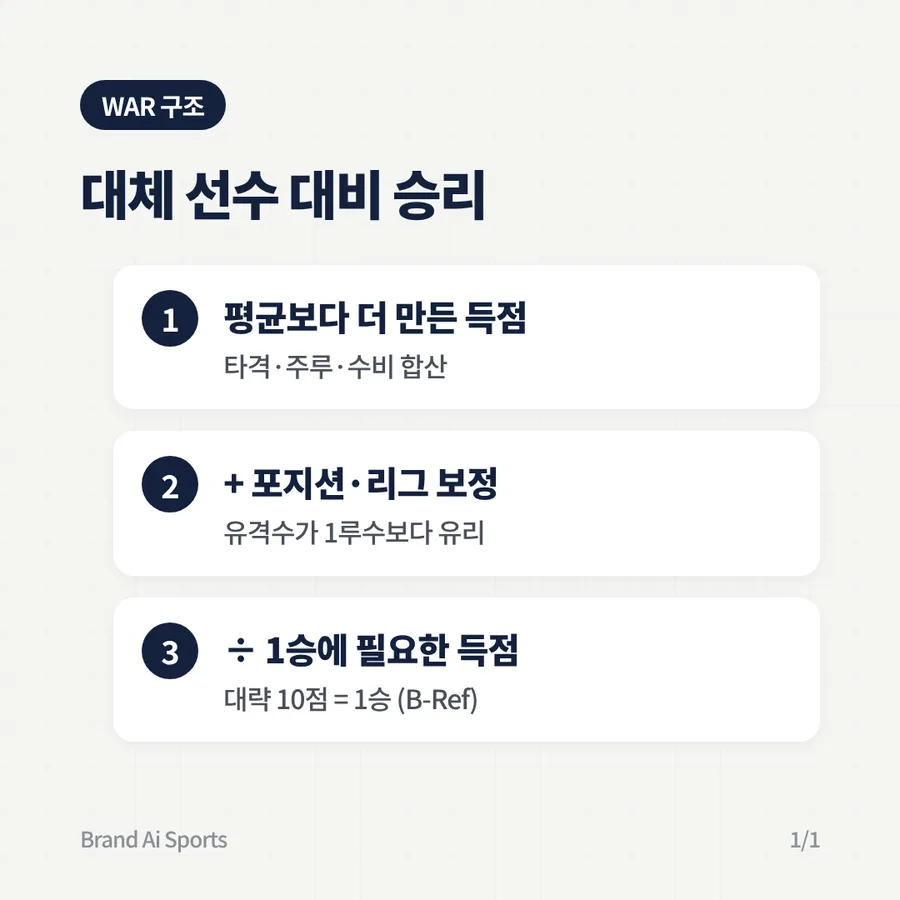

야구 기록의 **WAR(Wins Above Replacement, 대체 선수 대비 승리 기여)은 한 선수가 쉽게 구할 수 있는 대체 선수보다 팀에 몇 승을 더 가져다줬는지**를 나타냅니다. MLB.com 용어 사전에 따르면 WAR은 타격, 주루, 수비를 모두 합쳐 선수의 가치를 한 숫자로 보여 주는 지표입니다.

## 대체 선수란 누구인가

WAR의 기준이 되는 대체 선수는 평균 선수가 아닙니다. MLB.com은 대체 선수를 마이너리그에서 올라오는 선수나 쉽게 데려올 수 있는 FA처럼, 주전이 빠졌을 때 바로 메울 수 있는 수준의 선수로 설명합니다.

베이스볼 레퍼런스(Baseball-Reference)도 WAR이 알고 싶은 것은 "보통 대신 들어올 수 있는 선수보다 이 선수가 얼마나 나은가"라고 설명합니다. 먼저 선수를 평균과 비교하고, 그다음 이론상의 대체 선수를 평균과 비교해 두 결과를 더하는 구조입니다.

그래서 WAR 0은 "대체 선수 수준", 다시 말해 누구로 바꿔도 비슷한 선수라는 뜻입니다. WAR 3이라면 그 선수를 쓴 덕분에 팀이 대체 선수를 쓸 때보다 약 3승을 더 거뒀다고 읽습니다.

## WAR은 어떻게 계산하나

MLB.com이 소개한 야수 WAR 계산의 뼈대는 다음과 같습니다.

**(타격·주루·수비에서 평균보다 더 만든 득점 + 포지션 보정 + 리그 보정 + 대체 선수 수준 득점) ÷ 1승에 필요한 득점**

득점을 승리로 바꾸는 마지막 단계가 중요합니다. 베이스볼 레퍼런스는 대략 10점이 1승에 해당한다고 설명합니다. 소수점까지 표시하는 이유도 득점 단위와 연결하기 위해서라고 밝혔습니다.

투수는 계산 방식이 다릅니다. MLB.com에 따르면 투수 WAR은 RA9(9이닝당 실점)이나 FIP(수비 무관 평균자책점)를 바탕으로 리그와 구장 차이를 보정한 뒤, 리그 평균과 투구 이닝을 이용해 몇 승의 가치였는지 계산합니다.

## 포지션 보정: 유격수가 유리한 이유

MLB.com은 유격수와 1루수가 공격·수비·주루에서 똑같은 성적을 냈다면 **유격수의 WAR이 더 높다**고 설명합니다. 유격수 자리는 대체 선수의 성적 수준이 더 낮기 때문입니다.

쉽게 말해 잘 치는 1루수는 상대적으로 구하기 쉽지만, 잘 치면서 유격수 수비까지 되는 선수는 드뭅니다. WAR은 이 희소성을 포지션 보정으로 반영합니다. 그래서 같은 OPS라도 포지션에 따라 WAR이 달라집니다. 타격 지표만 궁금하다면 [야구 OPS 뜻과 계산법](/p/ops-meaning-calculation/)을 함께 보세요.

## 사이트마다 WAR이 다른 이유

WAR은 정답이 하나인 숫자가 아닙니다. MLB.com은 fWAR이 팬그래프(FanGraphs)의 WAR, bWAR 또는 rWAR이 베이스볼 레퍼런스의 WAR을 가리킨다고 설명합니다. 같은 선수라도 사이트마다 값이 조금씩 다릅니다.

베이스볼 레퍼런스는 WAR을 구하는 단계가 수백 개이고, 그 과정마다 합리적인 사람들끼리도 방법이 갈릴 수 있다고 밝혔습니다. 특히 투수를 실점(RA9) 기준으로 볼지, 수비 영향을 뺀 FIP 기준으로 볼지가 큰 차이를 만듭니다.

베이스볼 레퍼런스는 2013년 팬그래프 등과 논의해 대체 선수 수준을 맞췄고, 그 결과 2013년 메이저리그 전체 WAR이 1,000이 되도록 조정했다고 설명합니다. 사이트끼리 기준을 맞추려는 노력은 있지만 세부 계산은 여전히 다릅니다.

## WAR을 읽을 때 주의할 점

베이스볼 레퍼런스는 WAR이 근사치일 수밖에 없다며, 한 시즌 기준으로 두 선수 차이가 1~2승보다 작다면 확실한 차이로 보지 말라고 권합니다. 수비 지표가 들어가면 오차가 더 커진다는 설명도 덧붙였습니다.

이 글에서 권하는 판단 기준은 두 가지입니다. 첫째, **WAR 차이가 1~2 이내면 비슷한 선수로 본다.** 둘째, **사이트를 섞어 비교하지 않는다.** 팬그래프 값과 베이스볼 레퍼런스 값을 섞으면 실제보다 차이가 크거나 작게 보일 수 있습니다.

같은 이유로 선수끼리 비교할 때는 한 사이트의 값만 골라 쓰고, 그 사이트의 계산 방식 설명을 한 번 읽어 두면 숫자를 훨씬 정확하게 해석할 수 있습니다.

## 자주 묻는 질문

**WAR은 높을수록 좋은 건가요?**

네. 대체 선수보다 더 많은 승리를 가져왔다는 뜻이라 높을수록 좋습니다. 0은 대체 선수 수준, 마이너스는 대체 선수보다 못했다는 뜻입니다.

**fWAR과 bWAR은 무엇이 다른가요?**

MLB.com에 따르면 fWAR은 팬그래프, bWAR(rWAR)은 베이스볼 레퍼런스가 계산한 WAR입니다. 투수를 FIP로 볼지 실점으로 볼지 등 계산 방식이 달라 값이 다릅니다.

**1승은 몇 점인가요?**

베이스볼 레퍼런스는 대략 10점이 1승에 해당한다고 설명합니다. 다만 리그 득점 환경에 따라 달라집니다.

**같은 성적인데 포지션에 따라 WAR이 다른 이유는요?**

포지션 보정 때문입니다. MLB.com은 유격수가 1루수보다 대체 선수 수준이 낮아, 같은 성적이면 유격수의 WAR이 더 높다고 설명합니다.

**WAR 1 차이는 큰 차이인가요?**

베이스볼 레퍼런스는 한 시즌 차이가 1~2승보다 작으면 확실한 차이로 보지 말라고 권합니다.

## 핵심 요약

- WAR(대체 선수 대비 승리 기여)은 MLB.com 정의에 따라 한 선수가 같은 포지션의 대체 선수보다 팀에 몇 승을 더 가져왔는지를 타격·주루·수비를 합쳐 나타낸 지표입니다.
- 베이스볼 레퍼런스에 따르면 WAR은 득점을 승리로 바꿔 계산하며 대략 10점이 1승에 해당합니다.
- fWAR(팬그래프)과 bWAR(베이스볼 레퍼런스)은 계산 방식이 달라 같은 선수도 값이 다르며, 한 시즌 1~2승 이내 차이는 확실한 차이로 보기 어렵습니다.

## 참고한 자료

- [Wins Above Replacement (WAR)](https://www.mlb.com/glossary/advanced-stats/wins-above-replacement) — MLB.com 용어 사전, 확인일 2026-11-28
- [WAR Explained](https://www.baseball-reference.com/about/war_explained.shtml) — Baseball-Reference.com, 확인일 2026-11-28
- 사진 일부: Pixabay (무료 이용 허가 이미지)

정보 기준일: 2026-11-28. WAR 계산 방식은 사이트마다 바뀔 수 있으니 각 사이트의 설명 페이지를 함께 확인하세요.
