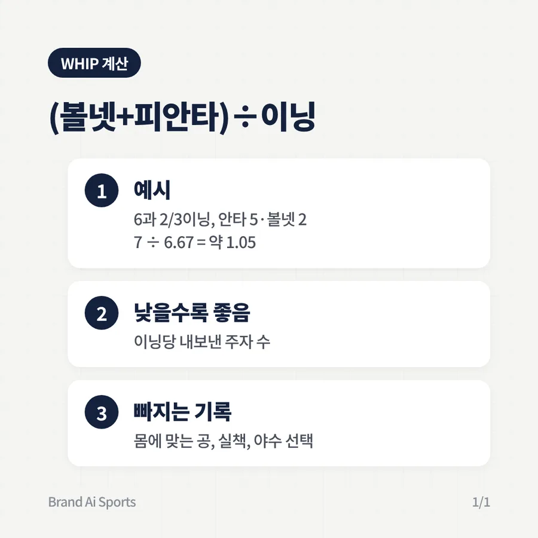

야구 기록의 **WHIP(이닝당 출루허용률)은 투수가 한 이닝에 볼넷과 안타로 내보낸 주자 수**를 뜻합니다. MLB.com 용어 사전에 따르면 계산식은 (볼넷 + 피안타) ÷ 투구 이닝이고, 숫자가 낮을수록 주자를 적게 내보낸 투수입니다.

## WHIP은 무엇을 보여 주나

WHIP은 Walks plus Hits per Inning Pitched의 머리글자입니다. 한국야구위원회(KBO) 공식 기록실의 투수 기록 표에도 WHIP 항목이 있고, 항목 설명에는 '이닝당 출루허용률'이라고 적혀 있습니다.

MLB.com은 WHIP을 투수 평가에 가장 널리 쓰이는 기록 가운데 하나로 소개합니다. 투수의 주요 목표 중 하나가 주자를 베이스에 보내지 않는 것이고, WHIP은 그 목표를 얼마나 잘 지켰는지를 한 숫자로 보여 주기 때문입니다.

이름의 뿌리도 흥미롭습니다. MLB.com에 따르면 판타지 야구(로티서리 리그)를 고안한 작가 대니얼 오크렌트가 1979년 이 지표를 처음 만들었고, 처음에는 'innings pitched ratio'라고 불렀다가 지금의 WHIP으로 굳어졌습니다.

## WHIP 계산법과 예시

계산은 간단합니다. 볼넷과 피안타를 더한 뒤 투구 이닝으로 나눕니다.

**WHIP = (볼넷 + 피안타) ÷ 투구 이닝**

예를 들어 한 투수가 6과 3분의 2이닝 동안 안타 5개와 볼넷 2개를 내줬다고 해 봅시다. 볼넷과 안타를 더하면 7이고, 6과 3분의 2이닝은 소수로 약 6.67이닝입니다. 7을 6.67로 나누면 WHIP은 약 1.05가 됩니다.

이닝은 아웃 3개가 한 단위라 3분의 1, 3분의 2 같은 조각이 생깁니다. 직접 계산할 때는 아웃 1개를 0.333이닝, 2개를 0.667이닝으로 바꿔 나누면 됩니다. 시즌 기록처럼 이닝이 많으면 이 차이는 거의 사라지지만, 한두 경기 기록을 계산할 때는 분수를 정확히 바꿔야 값이 맞습니다.

## WHIP에 포함되지 않는 것

MLB.com 용어 사전은 WHIP이 타자가 어떤 방식으로 출루했는지는 따지지 않는다고 설명합니다. 그래서 다음 경우는 WHIP 계산에 들어가지 않습니다.

- **몸에 맞는 공(사구)**
- **실책으로 출루한 타자**
- **야수 선택으로 출루한 타자**

같은 이유로 홈런과 단타도 WHIP에서는 똑같이 주자 1명으로 계산됩니다. MLB.com도 홈런이 볼넷보다 투수에게 훨씬 해롭다는 점을 WHIP의 한계로 짚었습니다.

## 평균자책점(ERA)과 함께 읽는 법

WHIP은 혼자 보기보다 평균자책점과 함께 볼 때 쓸모가 커집니다. MLB.com에 따르면 평균자책점은 투수가 9이닝당 내준 자책점으로, 9 × 자책점 ÷ 투구 이닝으로 계산합니다. WHIP이 "주자를 얼마나 내보냈나"를 본다면, 평균자책점은 "결국 점수를 얼마나 줬나"를 봅니다.

이 글에서 권하는 판단 기준은 두 기록의 어긋남을 보는 것입니다.

| 조합 | 읽는 법 |
| --- | --- |
| WHIP 낮음, 평균자책점 높음 | 주자는 적은데 실점이 많다. 장타·홈런 허용이 잦았는지 확인 |
| WHIP 높음, 평균자책점 낮음 | 주자는 많은데 실점을 막았다. 위기 관리나 수비 도움, 운의 영향 가능성 |
| 둘 다 낮음 | 출루 억제와 실점 억제가 모두 좋은 상태 |

특히 WHIP이 높은데 평균자책점이 낮은 투수는 지금 성적이 유지될지 한 번 더 따져 볼 만합니다. 주자를 자주 내보내면 실점 위험이 계속 쌓이기 때문입니다. 타자 쪽 출루 지표가 궁금하다면 [야구 OPS 뜻과 계산법](/p/ops-meaning-calculation/)도 함께 보세요.

## 기록실에서 WHIP 찾는 법

KBO 공식 기록실의 투수 기본 기록 표에는 평균자책점(ERA), 경기 수, 승패, 이닝(IP), 피안타(H), 볼넷(BB), 사구(HBP), 탈삼진(SO), 실점(R), 자책점(ER)과 함께 WHIP이 나옵니다. 같은 표에 피안타와 볼넷이 있으니 앞의 계산식으로 직접 검산해 볼 수 있습니다.

정렬 기능을 쓸 때는 WHIP과 평균자책점이 낮을수록 좋은 기록이라는 점만 기억하면 됩니다. 규정 이닝을 채우지 못한 투수는 이닝이 적어 한두 경기로 WHIP이 크게 흔들리니, 이닝 수를 함께 보는 습관이 필요합니다.

## 자주 묻는 질문

**WHIP은 높을수록 좋은 건가요?**

아닙니다. WHIP은 이닝당 내보낸 주자 수라서 낮을수록 좋은 기록입니다. MLB.com도 WHIP이 가장 낮은 투수들이 대체로 리그 최고 투수라고 설명합니다.

**몸에 맞는 공도 WHIP에 들어가나요?**

MLB.com 정의에 따르면 들어가지 않습니다. 사구, 실책, 야수 선택으로 출루한 경우는 WHIP 계산에서 빠집니다.

**WHIP과 피안타율의 차이는 무엇인가요?**

WHIP은 안타에 볼넷까지 더해 이닝으로 나눈 값이고, 피안타율은 상대 타자에게 안타를 맞은 비율입니다. 볼넷이 많은 투수는 피안타율이 낮아도 WHIP이 높게 나올 수 있습니다.

**WHIP은 누가 만들었나요?**

MLB.com에 따르면 판타지 야구를 고안한 작가 대니얼 오크렌트가 1979년에 처음 만들었고, 처음 이름은 innings pitched ratio였습니다.

**구원 투수도 WHIP으로 비교해도 되나요?**

비교할 수 있지만 이닝이 적어 한두 경기 결과로 숫자가 크게 바뀝니다. 구원 투수는 이닝 수를 함께 보고 판단하는 편이 정확합니다.

## 핵심 요약

- 야구의 WHIP(이닝당 출루허용률)은 MLB.com 정의에 따라 (볼넷 + 피안타) ÷ 투구 이닝으로 계산하며, 낮을수록 주자를 적게 내보낸 투수입니다.
- WHIP 계산에는 몸에 맞는 공, 실책, 야수 선택으로 출루한 타자가 포함되지 않고, 홈런과 단타도 똑같이 주자 1명으로 계산됩니다.
- KBO 공식 기록실 투수 기록 표에서 WHIP을 확인할 수 있으며, 평균자책점(9 × 자책점 ÷ 이닝)과 함께 보면 투수의 출루 억제와 실점 억제를 나눠 판단할 수 있습니다.

## 참고한 자료

- [Walks And Hits Per Inning Pitched (WHIP)](https://www.mlb.com/glossary/standard-stats/walks-plus-hits-per-inning-pitched) — MLB.com 용어 사전, 확인일 2026-11-28
- [Earned Run Average (ERA)](https://www.mlb.com/glossary/standard-stats/earned-run-average) — MLB.com 용어 사전, 확인일 2026-11-28
- [투수 기본 기록](https://www.koreabaseball.com/Record/Player/PitcherBasic/Basic1.aspx) — KBO 공식 기록실, 확인일 2026-11-28
- 사진 일부: Pixabay (무료 이용 허가 이미지)

정보 기준일: 2026-11-28. 기록 사이트마다 세부 계산 방식이 다를 수 있으니 공식 기록실의 항목 설명을 함께 확인하세요.
